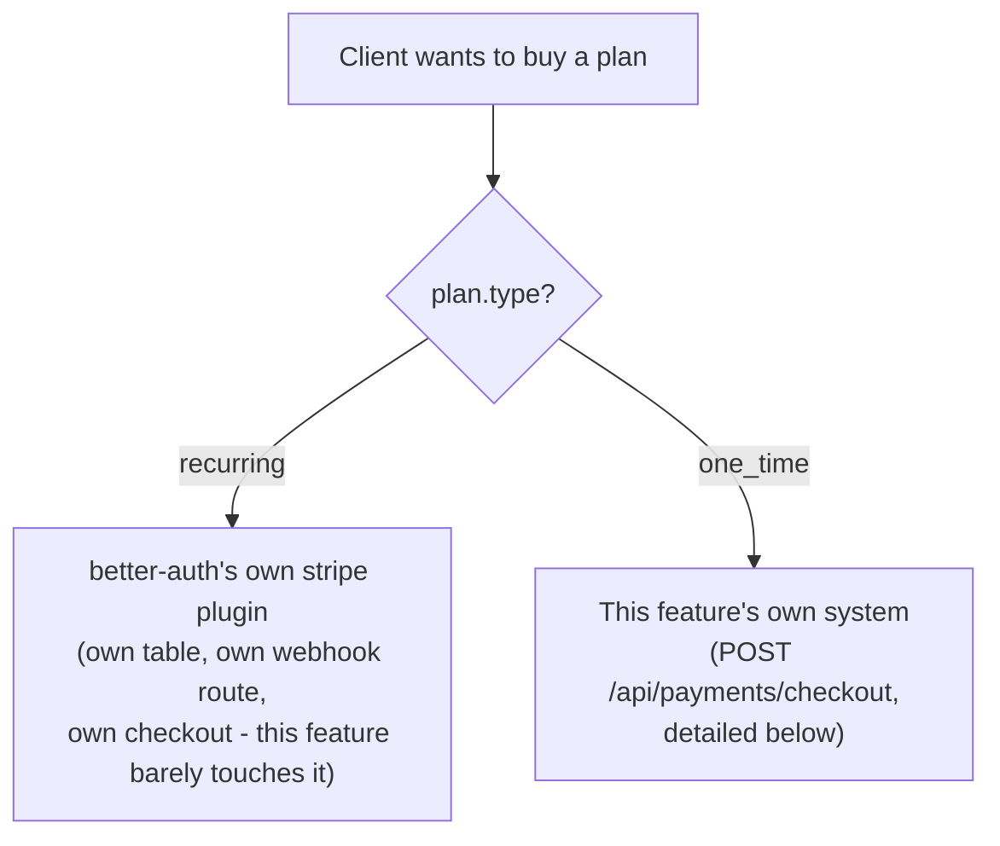
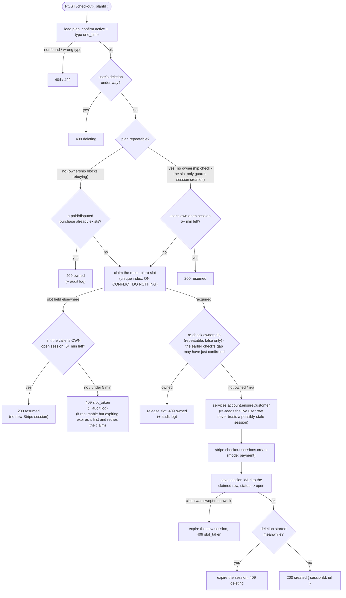
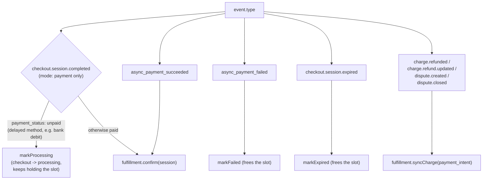

# Payments control flow

How `src/features/payments` behaves at runtime, organized for someone new to this
feature. See the [README](../../../README.md#payments) for the endpoint table.

Start with **"Plan configuration"** below — almost every behavior described later is a
direct consequence of how a given `plan` row is configured, not a special case.

## Overview

`plan.type` picks the entire system:

`recurring` is subscriptions, and is almost entirely `@better-auth/stripe`'s code: its
own `subscription` table, its own webhook handling, its own checkout. This doc covers
`one_time` in depth, and touches `recurring` only where the two cross over (retirement,
deletion, access checks).

### Layering

`route.ts` → `paymentsServices` → `paymentsRepo`, no skipping down. `route.ts` is the
only HTTP-aware layer. `paymentsServices` holds every Stripe call and branching
decision. `paymentsRepo` is plain Postgres, one query per file, no Stripe, no
branching. Non-route entry points: `lib/webhook.ts` (Stripe webhook), `lib/auth-hooks.ts`
(better-auth hooks), `scripts/reconcile.ts` (CLI).

### Data model

| Table | Holds | Lifetime |
| --- | --- | --- |
| `plan` | Price, type, `repeatable`/`durationDays`/`overlapping` policy | Forever |
| `checkout` | One in-flight purchase attempt | Minutes (`reserving`) → 24h (`open`) → 28d (`processing`) → kept forever, terminal |
| `purchase` | One confirmed payment, written once by `fulfillment.confirm` | Forever — the financial record |
| `payment_audit_log` | Races/exceptions around `plan.repeatable` | Forever |

One index drives the whole `checkout` lifecycle: `checkout_active_slot`, a partial
unique index on `(user_id, plan_id, slot)` while `status` is
`reserving`/`open`/`processing`. At most one in-flight checkout per (user, plan) —
every flow below just moves a row into or out of that predicate.

## Plan configuration: the knobs that drive everything

Four columns on `plan` decide which path a purchase takes. The first splits the whole
feature in two; the other three only apply to `one_time` plans (`insertPlanSchema`
rejects them being set on a `recurring` plan, and rejects `trialDays` on a `one_time`
one).

| Column | Applies to | Meaning | Who reads it |
| --- | --- | --- | --- |
| `type` | both | `one_time` → this feature's checkout/webhook system. `recurring` → better-auth's stripe plugin | almost everything below |
| `repeatable` | `one_time` | can the same user buy this plan more than once, ever | the checkout slot guard and `fulfillment.confirm`'s re-check (a `paid`/`disputed` purchase blocks; only `refunded` frees it) |
| `durationDays` | `one_time` | days of access one purchase grants, from its own `createdAt`; `null` = never expires | `addPurchase`, which snapshots it onto the purchase row and derives `expiresAt` |
| `overlapping` | `one_time` | when a user holds several paid purchases of the plan, do their access windows run concurrently (`true`) or chain end-to-end (`false`) | `addPurchase` (snapshots it), `isPurchaseAccessActive` (reads each purchase's own snapshot) |
| `trialDays` | `recurring` | subscription trial length | entirely `@better-auth/stripe` |
| `active` | both | `false` = retired: stops new purchases/subscriptions; existing holders keep access per `RETIRED_PLANS_KEEP_ACCESS` | checkout, `/subscription/upgrade`, the access check |

`repeatable`/`durationDays`/`overlapping` are three **independent** axes, not a single
"plan style" field — they combine, and the combinations are what a newcomer actually
needs to recognize. A plan's `limits`/`active`/`repeatable`/`durationDays`/`overlapping`/`trialDays`
are all editable later via `PATCH /plans/:id`; pricing/identity fields (`name`, `type`,
`amount`, `interval`, the Stripe ids) are fixed at creation. An edit only affects
checkouts started *after* it — see "Known races" below for the narrow window where that
isn't quite true.

### Common configurations

| What you're building | `repeatable` | `durationDays` | `overlapping` | What happens |
| --- | --- | --- | --- | --- |
| Lifetime purchase ("buy once, own forever") | `false` | `null` | — | One purchase, access never expires. Buying again 409s (`owned`) until the purchase is refunded. |
| Time-boxed pass ("30-day pass") | `false` | `30` | — | One purchase ever, access for 30 days from purchase. **Not renewable by rebuying** — once used, `repeatable: false` keeps blocking a second purchase even after the first one's access has lapsed. This is also the one-time "paid trial" pattern (e.g. $1 for 7 days) — see "The trial pattern" below. |
| Consumable / stackable pack ("extend access by 30 days", a top-up) | `true` | `30` | `false` | Buy as many times as you like. Each purchase's 30 days chains onto the end of whatever access the user already has, rather than resetting or running in parallel. |
| Repeatable, independently-timed access | `true` | `30` | `true` | Buy any number of times; each purchase's window runs from its own `createdAt`, independent of the others (useful when a purchase grants something other than "more of the same day count", e.g. per-purchase credits). |
| Subscription | n/a (`recurring`) | n/a | n/a | Entirely `@better-auth/stripe` — its own checkout, its own `subscription` table, its own cancel/upgrade. Add `trialDays` for a free trial. |
| Retired legacy plan | — | — | — | `active: false`. No new purchases or subscription upgrades to it. Existing holders keep access (`RETIRED_PLANS_KEEP_ACCESS`, on by default) unless the product explicitly wants to end access on retirement. |

Turning `repeatable` from `false` → `true` is unrestricted. The reverse (`true` →
`false`) is rejected with 409 while any user already holds a blocking purchase of the
plan — otherwise a once-only plan would silently stay open to everyone who already
bought it under the old terms, just not new buyers.

## `POST /checkout`: creating a one-time Checkout Session

One function, `services.checkout.start`, does everything below; `route.ts` only maps
its `{ kind }` result to a status code. Everything from the claim onward runs in one
`try`/`finally` — the claimed row is always released on failure, so a DB/Stripe error
frees the slot immediately rather than waiting out `RESERVATION_TTL_SEC`.

### The slot

One partial unique index, `checkout_active_slot` on `(user_id, plan_id, slot) WHERE
status IN ('reserving', 'open', 'processing')`, is the entire guard. Leaving the
predicate (any terminal status) is what frees the slot.

| phase | non-repeatable | repeatable |
| --- | --- | --- |
| `reserving` | `slot = 1` | `slot = 1` — the creation lock |
| `open` / `processing` | `slot = 1` | `slot = NULL` — released |
| terminal | outside the index | outside the index |

A repeatable plan still gets one Stripe call per (user, plan) in flight (the creation
lock), but its open or settling session doesn't block the *next* purchase — that's the
`slot -> NULL` on open. A non-repeatable plan keeps `slot = 1` the whole way, which is
what makes it rebuyable again only once the session leaves the index entirely.

### `GET /checkout/:sessionId`

Polls `purchase` first, then falls back to the `checkout` row, then `null` → 404.
`failed`/`expired` answer 200 (not 404) and are kept forever.

### Extension point: `lib/checkout-extensions.ts`

`createCheckout` calls `getCheckoutSessionParams({ user, plan })` before building the
Stripe request — a no-op by default, for an app wanting promo codes, tax, or custom
`line_items`. Mirrors `@better-auth/stripe`'s own `subscription.getCheckoutSessionParams`.

| Always wins over the extension | Why |
| --- | --- |
| `mode`, `customer`, `client_reference_id`, `success_url`, `cancel_url`, `expires_at` | This flow's own identity |
| `metadata`/`payment_intent_data.metadata`'s `userId`/`planId`/`durationDays`/`overlapping` | `fulfillment.confirm` and the reconciler resolve a session back to a purchase from these |
| `metadata`/`payment_intent_data.metadata`'s `source` key | Marks a session as this app's at all — see "isOurs" below |
| *(not protected)* `line_items` | Fully replaceable — one checkout is still one purchase, whatever the quantity |

## Stripe webhook dispatch

Every Stripe event — recurring or one-time — lands on better-auth's
`/api/auth/stripe/webhook`. It handles `customer.subscription.*` itself, then
*always* forwards the raw event to this app's `onEvent` hook, `handleStripeEvent`
(`lib/webhook.ts`), regardless of type. That's a thin `switch` with no business logic
of its own:

Everything else — including every subscription event — is a no-op here; the plugin
already handled it. `markProcessing`/`markFailed`/`markExpired` are guarded transitions
(`CHECKOUT_TRANSITIONS_FROM` in `lib/constants.ts`): each only applies from an allowed
set of prior statuses, so a retried or out-of-order event can't move a status backward.

### `fulfillment.confirm`: turning a paid session into a `purchase` row

First, `isOurs` decides whether the session is this app's at all (tagged with a
`source` metadata key every session `createCheckout` makes carries, or — for an older
session — matched against a `checkout` row). Anything else on the same Stripe account
(a Payment Link, the Dashboard, another app) is skipped, not recorded.

Then it resolves the owner (`checkout` row first, falling back to session metadata),
loads the plan, and inserts the `purchase` row — idempotent on
`stripeCheckoutSessionId`, so a retried webhook delivery is a no-op. `durationDays` and
`overlapping` come from the **session's own metadata snapshot**, taken at checkout
creation time, not the plan's current value — an admin editing the plan while a
purchase is mid-flight must not change what that buyer gets. `purchasedAt` is when
Stripe recorded the payment as succeeded, not insert time and not session-creation
time — see "Known races" for why both of those would be wrong.

After a successful insert for a non-repeatable plan, it re-checks for a *different*
already-blocking purchase of the same plan — the double-confirmation race, see "Known
races" below.

### `fulfillment.syncCharge`: refunds and disputes

Never trusts a webhook event's own embedded payload — always re-fetches the current
charge/dispute state from Stripe (`resolveChargeState`), the same function the
reconciler uses. Status comes from the charge's refund state; an *open* or *lost*
dispute overrides it, a dispute *won* or closed favorably defers back to the refund
state instead of forcing `paid` (see "Known races" for why that matters).

The write is a compare-and-set on the purchase row's `version`, with up to 3
read-fetch-write retries — see "Known races" below.

An *increase* in `amountRefunded` emails the buyer a refund confirmation. A
*decrease* (a refund Stripe accepted as pending that then failed or was canceled)
emails every admin instead — see "Known races".

## The reconciler: `services/reconcile.ts` (`bun run payments:reconcile`)

A backstop for webhooks Stripe gave up retrying, run on a schedule (see the README's
cron section). Two independent passes:

- **`purchases`** — lists recent one-time Checkout Sessions from Stripe directly and,
  per session, inserts a missing `purchase` row via the same `fulfillment.confirm`,
  then re-syncs refund/dispute state the same way the webhook does. Also settles any
  `checkout` row still `processing` past its webhook (a delayed payment that never got
  its success/failure event). Default scan window: 28 days, because delayed payment
  methods (SEPA debits) can take that long to settle.
- **`subscriptions`** — a separate pass correcting `subscription` rows left stale by a
  lost or out-of-order `customer.subscription.*` webhook. Bulk-lists live subscriptions
  from Stripe, diffs each against its stored row, and corrects drifted fields
  (`status`, period/trial dates, `cancelAtPeriodEnd`, and — notably — `plan`, since a
  lost webhook for a plan *change* is exactly the kind of staleness this exists to
  catch). A row already canceled or `incomplete_expired` is skipped — Stripe guarantees
  those never change again.

`scripts/reconcile.ts` is a thin CLI wrapper (arg parsing, exit code) around both.

## Checking active access: `GET /plans/:id/access` and `GET /access`

`services.plan.access` answers "does the caller hold this plan right now", branching
on `plan.type` the same way checkout does:

- **`one_time`**: `isPurchaseAccessActive` walks the user's access-granting purchases
  of the plan in `createdAt` order, using **each purchase's own `overlapping`/`durationDays`
  snapshot** (not the plan's current value) to decide whether its window runs
  independently or chains onto the previous one's end. This is the one place
  `overlapping` actually matters at read time.
- **`recurring`**: reads better-auth's own `subscription` table directly (not the
  plugin's `/subscription/list` endpoint — this only needs a boolean). Active statuses
  are `active`/`trialing`; `past_due` is deliberately excluded by default (access ends
  the moment a renewal payment fails, not after Stripe's retry schedule runs out) — see
  `lib/access-policy.ts` to change that.

A retired (`active: false`) plan is hidden (404) from anyone who doesn't currently
hold it and isn't an admin — same visibility rule `GET /plans/:id` already uses.

`GET /access` is the same logic applied across every plan the caller holds, for an app
that gates features by what's held rather than by one specific plan id.

### Access policy knobs (`lib/access-policy.ts`)

Every product decision about who has access is a named constant here, not buried in a
query:

| Setting | Default | Change it to |
| --- | --- | --- |
| `SUBSCRIPTION_ACCESS_STATUSES` | `active`, `trialing` | add `past_due` for a grace period during Stripe's retries |
| `PURCHASE_ACCESS_STATUSES` | `paid` | add `disputed` to keep access until a dispute is lost |
| `PURCHASE_BLOCKING_STATUSES` | `paid`, `disputed` | what stops a non-repeatable plan being bought again |
| `PARTIAL_REFUND_REVOKES_ACCESS` | `false` | `true` to end access on any refund |
| `DISPUTE_INQUIRY_REVOKES_ACCESS` | `true` | `false` to keep access while the issuer only inquires |
| `RETIRED_PLANS_KEEP_ACCESS` | `true` | `false` to end access when a plan is deactivated |
| `RETIRING_EXPIRES_OPEN_CHECKOUTS` | `true` | `false` to let checkouts already open when a plan is retired still complete |
| `CANCEL_ON_USER_DELETE` | cancel now, no proration | `prorate: true` to credit unused time |

## Refunding a purchase: `POST /purchases/:id/refund`

Admin-only. Calls Stripe's `refunds.create`, then re-syncs the purchase's state the
same way the webhook does rather than computing it locally. Requires a caller-supplied
`idempotencyKey` — one per refund the admin *means* to issue; resending it retries that
same refund, a new key always means a genuinely new refund (even same amount/reason).

| Outcome | Status |
| --- | --- |
| `refunded` (new or replayed) | 200 |
| `not_found` | 404 |
| `no_payment_intent` / `amount_exceeds_refundable` / `refund_failed` | 422 |
| `already_refunded` / `charge_disputed` / `idempotency_conflict` | 409 |

## Retiring a plan: `PATCH /plans/:id { active: false }`

Stops new purchases/upgrades, keeps existing ones working:

1. **In Stripe:** the plan's price(s) are archived (restored on reactivation) — this
   only guards the app's own endpoints; a Customer Portal or Payment Link on the same
   Stripe account is a separate door.
2. **Open checkouts:** per `RETIRING_EXPIRES_OPEN_CHECKOUTS` (on by default), every
   open session for the plan is expired too — otherwise a session created just before
   retirement would stay payable for up to 24h.
3. **`one_time`:** `POST /checkout` already 404s an inactive plan. Existing purchases
   keep access per `RETIRED_PLANS_KEEP_ACCESS`.
4. **`recurring`:** a hook on better-auth's `hooks.before` refuses `/subscription/upgrade`
   (new subscriptions *and* plan switches) to a retired plan. Cancel/restore/billing
   portal aren't gated and keep working either way.

Changing a price for existing subscribers isn't supported this way: create a new plan,
retire the old one.

## Deleting a user

`services.account.prepareDeletion` is wired into better-auth's
`databaseHooks.user.delete.before`, run by both the admin plugin's `removeUser` and
self-service deletion. In order:

1. Raise a "this user is deleting" flag (Redis).
2. Expire every open Checkout Session the customer has — one-time and subscription
   checkouts alike.
3. Refuse the deletion (409) if a one-time payment is still *settling* (a delayed
   method whose session completed but whose payment intent hasn't resolved yet).
4. Cancel every non-terminal subscription, per `CANCEL_ON_USER_DELETE`.

Fails closed throughout: any Stripe/DB error aborts the deletion and clears the flag,
rather than deleting a user who's still being billed. The Stripe customer itself is
kept — its payment history is still needed for refunds/disputes after the user is gone.

## The trial pattern

Two unrelated things both get called "trial" — don't confuse them:

- **One-time paid trial** (e.g. $1 for 7 days): a `one_time` plan with
  `repeatable: false` and `durationDays` set. "Once ever per account, until refunded" —
  buying it does *not* become possible again once the access window lapses. See the
  "Common configurations" table above.
- **Subscription trial** (e.g. 14 days of Pro, then it bills): `trialDays` on a
  `recurring` plan, handled entirely by `@better-auth/stripe`. The one piece of this
  feature's own code involved is `withholdTrialFromUnverified` (`lib/trial-eligibility.ts`),
  which strips the trial from a checkout whose user isn't email-verified — otherwise
  every throwaway account would get a fresh trial, since sign-up needs no
  verification and the plugin's "one trial per account" check is keyed on the account,
  not the mailbox.

A genuinely free one-time plan can't be created directly (`amount` must be positive),
but a $0 checkout is possible via a 100% coupon through `getCheckoutSessionParams`, and
the flow handles it like any other completed session.

## Known races

Races this feature has had to reason about, and whether they're actually closed.
"Handled" means the race can happen but the outcome is still correct (or safely
detected); "not handled" means a real gap exists, scoped to how narrow it is.

| # | Race | Trigger | Status | How |
| --- | --- | --- | --- | --- |
| 1 | Two concurrent claims of the same (user, plan) slot | Two requests hit `POST /checkout` at once | **Handled** | `checkout_active_slot` partial unique index + `INSERT ... ON CONFLICT DO NOTHING` — only one claim can win |
| 2 | Two sessions for the same non-repeatable plan both confirm | Stripe retries after an outage, or the reconciler races the webhook | **Handled, by detection, not prevention** | Both purchases are recorded (money was taken either way, never silently dropped); whichever confirms second finds the other already there, logs `duplicate_purchase_confirmed`, and emails every admin. The double charge itself isn't prevented — a human decides the refund. |
| 3 | A slow request's reservation gets swept by someone else's claim before it can open the session | The claiming request stalls past `RESERVATION_TTL_SEC` | **Handled** | The session-open write only applies `WHERE id = <claimed row> AND status = 'reserving'`; losing that match falls back to expiring the new Stripe session and answering 409 |
| 4 | Resuming a session that's about to expire | Buyer comes back to a near-dead session | **Handled** | A session with under `CHECKOUT_RESUME_MIN_REMAINING_SEC` left is expired at Stripe and replaced with a fresh one instead of handed back |
| 5 | Two syncs of the same purchase's refund/dispute state race (two webhooks, or webhook vs. reconciler) | `charge.refunded` and `charge.dispute.created` land close together, or a retry overlaps | **Handled** | Compare-and-set on the purchase row's `version` (not on the status fields themselves, since those can change and change back); conflicting writers re-read, re-fetch, and retry up to 3 times, then throw so Stripe redelivers |
| 6 | A refund Stripe accepted as pending later fails or is canceled | `charge.refund.updated` with a lower `amount_refunded` | **Handled** | Detected as a decrease in `amountRefunded`; every admin is emailed. The original `refund_issued` audit entry is deliberately left in place — the trail shows "issued, then reversed," not rewritten history |
| 7 | A dispute closed in the merchant's favor masking an earlier real refund | `charge.disputed` stays true forever once opened | **Handled** | The dispute override only applies while a dispute is open or lost; a won/closed-favorable dispute defers back to the refund state instead of forcing `paid` |
| 8 | A card payment's webhook lands after the user row is already deleted | Payment completed in the instant before/during deletion | **Handled** | The purchase is still recorded, with `userId: null`, via a foreign-key-violation retry — never dropped, never blocks the webhook |
| 9 | A delayed payment is still settling at the moment of user deletion | A bank-debit checkout completed but its payment intent hasn't resolved | **Handled** | Deletion is refused (409) while a settling payment is found; checked both before and after the checkout-expiry pass, closing the gap where a session could complete mid-deletion |
| 10 | A new checkout or subscription upgrade is started while a deletion is mid-flight | Request lands between the expiry pass and the actual delete | **Handled** | A Redis-backed "deleting" flag is checked before *and* after session creation; fails closed (500, not "just" 409) if the flag can't be read at all |
| 11 | A `subscription` row is written stale by an out-of-order or retried `customer.subscription.*` webhook | Stripe doesn't guarantee delivery order | **Handled** | A separate reconciler pass (`services.reconcile.subscriptions`) diffs stored rows against live Stripe state and corrects drift |
| 12 | A subscription webhook lands *while* the subscription reconciler is mid-run | Reconciler pass overlaps real-time webhook traffic | **Handled** | Compare-and-set against the snapshot the row was read with; a changed row is skipped this run and re-checked next run, rather than overwritten |
| 13 | A subscription row the plugin created is never linked to its Stripe subscription id | The plugin's own checkout handler swallows its own linking error | **Handled** | The reconciler matches by the plugin's own internal `metadata.subscriptionId` tag and fills in the missing id |
| 14 | A subscription exists in Stripe with **no row at all** | — | **Not handled** | Out of scope for the reconciler, which only corrects/links existing rows. Considered low-risk: unlike one-time purchases, the plugin creates the row *synchronously* as part of its own checkout flow, before any webhook fires — a fully missing row would mean that write itself failed |
| 15 | A checkout is created/opened using a plan's *old* terms during the narrow window of a `PATCH` that changes `durationDays`/`overlapping`/`repeatable`/`active` | A request reads the plan just before the edit, but creates its Stripe session just after the edit's "expire open checkouts" listing has already run | **Not fully handled for terms edits** | The window is about one Stripe call wide. Retirement itself has no gap (the price is archived *before* the listing, so Stripe refuses any session created after), but a terms-only edit does. Any resulting double charge is still caught by race #2's detection |
| 16 | The better-auth stripe plugin logs an internal error on every one-time `checkout.session.completed` | It calls `subscriptions.retrieve` with no subscription id for every session, one-time included | **Not a race — known vendor noise** | Logged internally, not rethrown; harmless, but worth recognizing during on-call triage so it isn't mistaken for a real failure |

## Where the audit log and pagination fit

`payment_audit_log` is a persistent trail of the races above that actually fired
(`checkout_blocked_existing_purchase`, `checkout_blocked_pending_checkout`,
`duplicate_purchase_confirmed`, `refund_issued`) — all writes best-effort, never
blocking the response or webhook they're attached to. `GET /audit-log` (admin) and
`GET /purchases/all` (admin) both page the same way: keyset pagination via
`?limit=`/`?before=<nextCursor>`, so a page boundary doesn't shift as new rows arrive.
