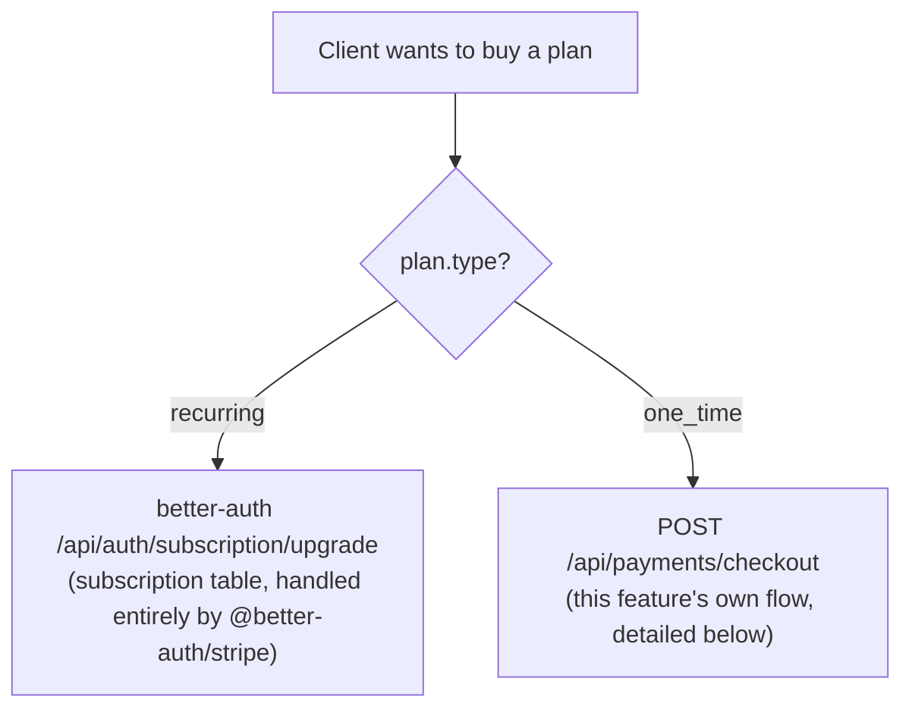
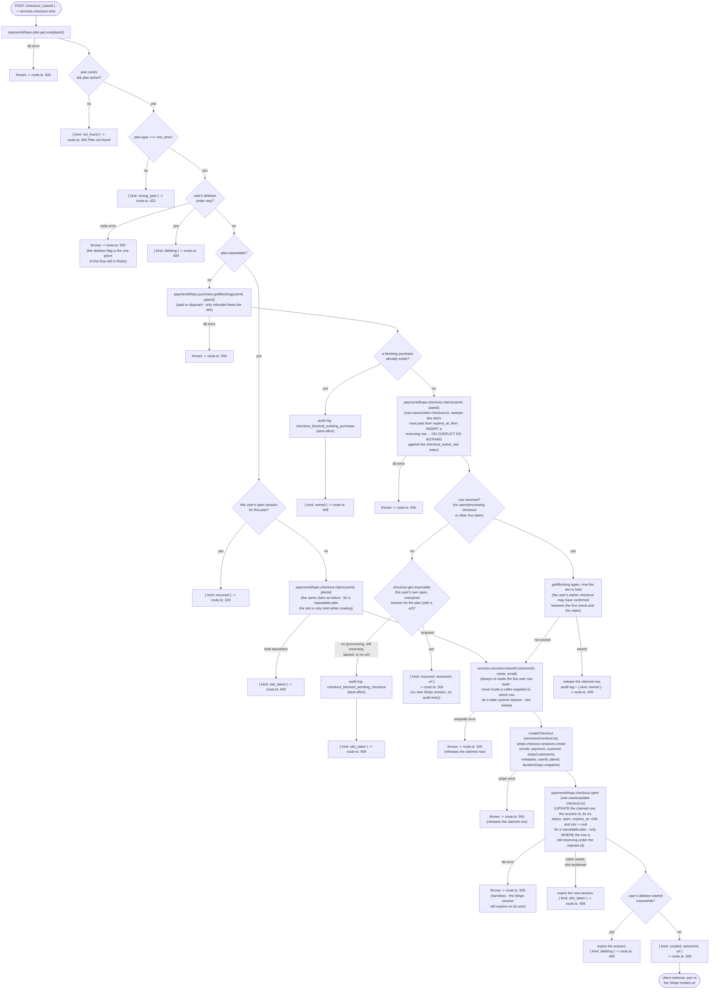
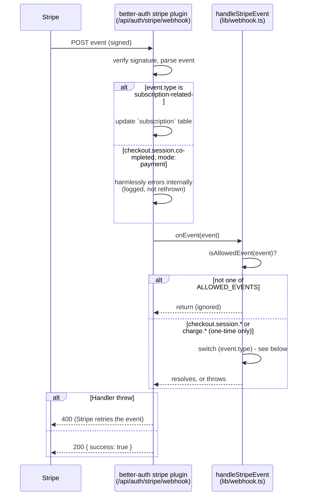
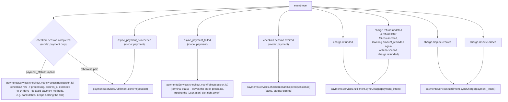
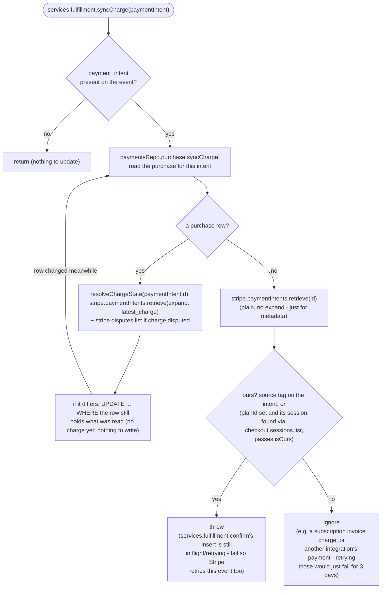
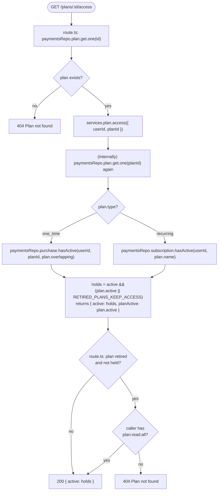
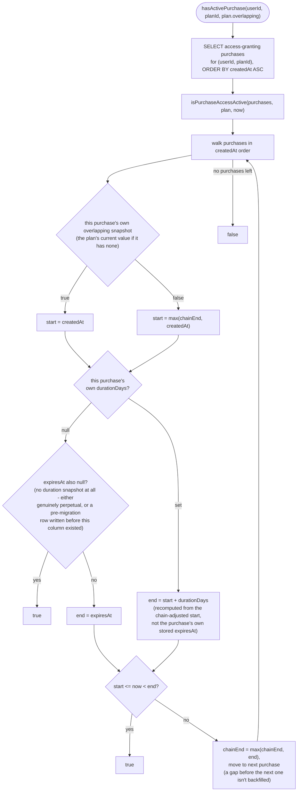
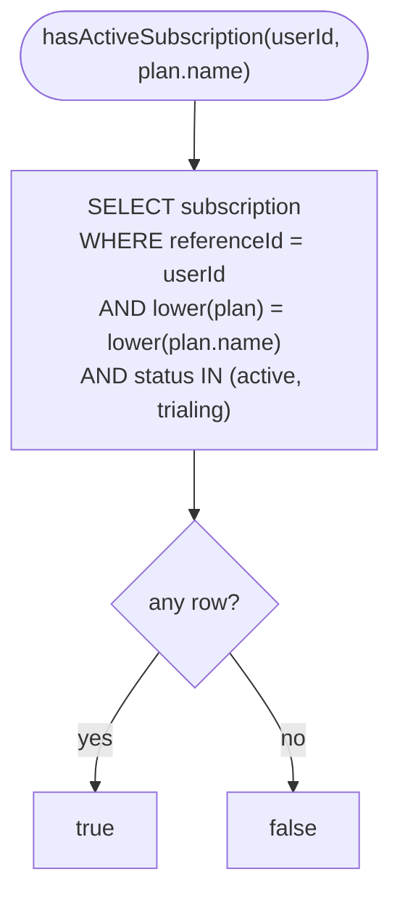

# Payments control flow

This documents how `src/features/payments` actually behaves at runtime. See the
[README](../../../README.md#payments) for the endpoint table and the two-plan-type summary.

## Overview

`plan.type` picks the system: `recurring` is better-auth's own stripe plugin (own table,
own webhook, own checkout); `one_time` is this feature's own. This doc covers `one_time`
only, except where the two cross over (retirement, deletion, access checks).

### Layering

`route.ts` → `paymentsServices` → `paymentsRepo`, no skipping down. `route.ts` is the only
HTTP-aware layer. `paymentsServices` holds every Stripe call and branching decision.
`paymentsRepo` is plain Postgres, one query per file, no Stripe, no branching. Non-route
entry points: `lib/webhook.ts` (Stripe webhook), `lib/auth-hooks.ts` (better-auth hooks),
`scripts/reconcile.ts` (CLI). Below, steps are named `layer.function` so each diagram
doubles as a code index.

### Data model

| Table | Holds | Lifetime |
| --- | --- | --- |
| `plan` | Price, type, `repeatable`/`durationDays`/`overlapping` policy | Forever |
| `checkout` | One in-flight purchase attempt | Minutes (`reserving`) → 24h (`open`) → 14d (`processing`) → kept forever, terminal |
| `purchase` | One confirmed payment, written once by `fulfillment.confirm` | Forever - the financial record |
| `payment_audit_log` | Races/exceptions around `plan.repeatable` | Forever |

One index drives the whole `checkout` lifecycle: `checkout_active_slot`, a partial unique
index on `(user_id, plan_id, slot)` while `status` is `reserving`/`open`/`processing`. At
most one in-flight checkout per (user, plan) - every flow below just moves a row into or
out of that predicate.

### What follows

| Section | Entry point | Does |
| --- | --- | --- |
| `POST /checkout` | `services.checkout.start` | Claims the slot, creates the session |
| Stripe webhook dispatch | `lib/webhook.ts`'s `handleStripeEvent` | Routes an event to a service call |
| The reconciler | `services/reconcile.ts`'s `purchases`/`subscriptions` | Backstops lost webhooks |
| Checking active access | `services.plan.access` | Does the caller hold this plan now |
| Retiring a plan | `services.plan.update` | Stops new purchases, expires open checkouts |
| Deleting a user | `services.account.prepareDeletion` | Expires checkouts, cancels subscriptions |

Everything after that (audit log, admin purchase listing, access policy, trial pattern,
field reference) is lookup material, not a flow.

## `POST /checkout`: creating a one-time Checkout Session

One function, `services.checkout.start`, does everything below; `route.ts` only maps its
`{ kind }` result to a status code. Everything from the claim onward runs in one
`try`/`finally` - the claimed row is always released, so a DB/Stripe failure frees the
slot immediately rather than waiting out `RESERVATION_TTL_SEC`.

### The slot

One partial unique index, `checkout_active_slot` on `(user_id, plan_id, slot) WHERE status
IN ('reserving', 'open', 'processing')`, is the entire guard. Leaving the predicate (any
terminal status) is what frees the slot - nothing else clears it.

| phase | non-repeatable | repeatable |
| --- | --- | --- |
| `reserving` | `slot = 1` | `slot = 1` - the creation lock |
| `open` / `processing` | `slot = 1` | `slot = NULL` - released |
| terminal | outside the index | outside the index |

Nulls never collide, so one column does both jobs: a repeatable plan still gets one Stripe
call per (user, plan) in flight, but its open or settling session doesn't block the next
purchase. The claimed row's own `id` is the reservation - `openCheckout` only writes to a
row still `reserving` under that id, so a claim swept by a fresh row (past its own
`expires_at` - `RESERVATION_TTL_SEC`/`PENDING_CHECKOUT_TTL_SEC`/`PROCESSING_TTL_SEC` per
status) can't be opened by the request that lost it.

### The two guards

Ownership for a non-repeatable plan is checked twice - once before claiming, once after -
because the user's earlier checkout can confirm in the gap between them. Safe either way:
`fulfillment.confirm` writes the purchase before it frees the slot (`markCompleted` runs
last), so any request that claims a freed slot already sees the purchase.

A failed claim isn't always a 409: if the slot is held by the caller's own still-`open`
session, they get that session back instead (`checkout.get.resumable`) - the "buyer closed
the tab" case. A repeatable plan checks for that resumable session *first*, since its own
open session no longer holds the slot. A session is only resumable while it has at least
`CHECKOUT_RESUME_MIN_REMAINING_SEC` left: Stripe expires it `CHECKOUT_SESSION_EXPIRY_MARGIN_SEC`
(10 minutes) before its row's own `expiresAt`, so going by the row alone handed back a
session Stripe would refuse whenever `checkout.session.expired` was late. For the same
reason, the claim's sweep frees an `open` row's slot once its session has expired (plus
`CHECKOUT_EXPIRY_CLOCK_SKEW_SEC` of slack), not at the row's deadline, and
`GET /checkout/:sessionId` reports such a row as `expired`. The deletion flag (`lib/state/deletion-guard.ts`) is
checked the same way - before claiming, and again once the session exists - so a deletion
starting mid-request still gets the session expired.

### `ensureCustomer`

Re-reads `stripeCustomerId` from Postgres on every call rather than trusting the session
(better-auth can serve a stale, Redis-cached blob), and writes a new id through
better-auth's `internalAdapter.updateUser` so the session cache picks it up too - the
subscription plugin's own upgrade path reads `stripeCustomerId` straight from the session,
and a stale `null` there creates a second Stripe customer and switches the user onto it. An
idempotency key (`customer-<userId>-<hash of email/name>`) keeps a retry from creating a
duplicate.

### Extension point: `lib/checkout-extensions.ts`

`createCheckout` calls `getCheckoutSessionParams({ user, plan })` before building the Stripe
request - a no-op by default, for an app wanting promo codes, tax, or custom `line_items`.
Mirrors `@better-auth/stripe`'s own `subscription.getCheckoutSessionParams`.

| Always wins over the extension | Why |
| --- | --- |
| `mode`, `customer`, `client_reference_id`, `success_url`, `cancel_url`, `expires_at` | This flow's own identity; `expires_at` must stay in lockstep with `PENDING_CHECKOUT_TTL_SEC` |
| `metadata`/`payment_intent_data.metadata`'s `userId`/`planId`/`durationDays` keys | `fulfillment.confirm` and the reconciler resolve a session back to a purchase from these |
| *(not protected)* `line_items` | Fully replaceable - doesn't change what's granted; one checkout is still one purchase, whatever the quantity |

### `GET /checkout/:sessionId`

Polls `purchase` first, then falls back to the `checkout` row, then `null` → 404.
`failed`/`expired` answer 200 (not 404) and are kept forever rather than aged out. An
`open`/`reserving` row past its own `expires_at` reads as `expired` even before anything
sweeps it.

## Stripe webhook dispatch

Every Stripe event - recurring or one-time - lands on the **same** endpoint,
`/api/auth/stripe/webhook`, owned by `@better-auth/stripe`. It verifies the
signature, handles `customer.subscription.*` internally (writing the
`subscription` table directly), then *always* forwards the raw event to the
`onEvent` hook this app wired up to `handleStripeEvent` in `lib/webhook.ts` -
regardless of event type. `handleStripeEvent` is a thin dispatcher: it holds no
business logic itself, just a `switch` over `event.type` that calls into
`paymentsServices.fulfillment`/`paymentsServices.checkout` for each branch (see
below).

The endpoint is exempt from better-auth's IP rate limiter (`rateLimit.customRules`
in `auth.ts`): it's authenticated by Stripe's signature instead, and the limiter
runs *before* that check - so without the exemption, a burst of real events, or
anyone flooding the path with unsigned requests while client IPs go unresolved
(every caller then shares one bucket), would get Stripe's deliveries 429'd.
With no rate limit, a 1 MB body cap (`bodyLimit` in `src/index.ts`, ahead of
better-auth's handler) is what bounds it instead: better-auth reads and HMACs the
whole body before it can reject a forged signature, so without the cap anyone
could stream arbitrarily large junk at it. Real Stripe events are a few KB.

Its own `checkout.session.completed` handler runs for **every** session mode
except `"setup"` - including one-time (`mode: "payment"`) sessions, not just
subscription ones. For a one-time session it calls `subscriptions.retrieve`
with no subscription id, which throws and is caught and logged internally as
`"Stripe webhook failed"` on every single one-time purchase - noisy, but
harmless, and worth knowing about so it isn't mistaken for a real error during
on-call triage (see "known noise" below).

`ALLOWED_EVENTS` (`lib/constants.ts`): `checkout.session.completed`,
`checkout.session.async_payment_succeeded`, `checkout.session.async_payment_failed`,
`checkout.session.expired`, `charge.refunded`, `charge.refund.updated`,
`charge.dispute.created`, `charge.dispute.closed`. Everything else (including every
subscription event) is a no-op for this feature - the plugin already dealt with
it above.

### `handleStripeEvent`'s switch

`markProcessing`/`markFailed`/`markExpired` (`paymentsServices.checkout.*`) are
thin wrappers over `paymentsRepo.checkout.transition`, a single `UPDATE ... WHERE
stripe_checkout_session_id = ... AND status IN (<allowed predecessors>)`. The
allowed predecessors live in `CHECKOUT_TRANSITIONS_FROM` (`lib/constants.ts`) and
are what keeps a status from moving backward: a retried or out-of-order event for
a status the session has already passed (e.g. a redelivered unpaid `completed`
arriving after `async_payment_failed`) matches no row and is a no-op. `failed` and
`expired` exclude each other, since neither is "later" than the other, and
`completed` can't be left at all. Because the check and the write are one
statement, two events landing together can't both read the old status and let the
earlier one write last.

Nothing separate has to be freed or kept alive. `markProcessing` extends the row's
own `expires_at` to `PROCESSING_TTL_SEC`, so the slot keeps blocking for as long
as a bank debit can still settle; `markFailed`/`markExpired` move the row out of
the `checkout_active_slot` index's predicate, which frees the slot by itself. A
retried transition for an old, superseded session only ever touches that session's
own row, so a newer checkout for the same (user, plan) is untouched by
construction.

### `services.fulfillment.confirm`: turning a paid session into a `purchase` row

First, `isOurs` (`services/checkout.ts`) decides whether the session is this app's
at all: tagged with `CHECKOUT_SOURCE_METADATA_KEY` (every session `createCheckout`
has made since the tag existed), or - for an older one - with a `checkout` row
recorded for it. Anything else on the same Stripe account (a Payment Link, the
Dashboard, another app) is logged as `payments.webhook.not_ours` and skipped,
even if its metadata happens to carry `planId`/`userId`. The reconciler's scan and
plan retirement's `expireOpenCheckoutsForPlan` apply the same check.

Both drop branches below **throw** rather than log-and-return: a silently
swallowed 200 would mean a payment with no trace of ever going wrong (Stripe
never retries, and a later reconciler pass that hits the same drop would
otherwise miscount it as a successful insert - see the reconciler section).

```mermaid
flowchart TD
    Start(["services.fulfillment.confirm(session)"]) --> IsOurs{"isOurs(session):\nsource tag, or a\ncheckout row?"}
    IsOurs -- no --> NotOursEarly["log warning: payments.webhook.not_ours,\nreturn false"]
    IsOurs -- yes --> ResolveOwner["resolveOwner (private helper):\npaymentsRepo.checkout.get.bySession(session.id)"]
    ResolveOwner --> HasPending{"checkout row\nfound?"}
    HasPending -- yes --> Owner["{ userId, planId }"]
    HasPending -- no, or db error --> Metadata["fall back to\nsession.metadata\n(set on the session at createCheckout time)"]
    Metadata --> HasMetadata{"metadata has\nuserId + planId?"}
    HasMetadata -- yes --> Owner
    HasMetadata -- no --> HasPlanId{"metadata has\na planId at all?"}
    HasPlanId -- no --> NotOurs["log warning: payments.webhook.not_ours,\nreturn (not a drop - a payment-mode session\nthis app never created, e.g. a Payment Link\nor another integration on the same account)"]
    HasPlanId -- yes, but still unresolvable --> Throw1["throw\n(ours, genuinely broken -\nlogged first: payments.webhook.metadata)"]

    Owner --> FetchPlan["paymentsRepo.plan.get.one(planId)"]
    FetchPlan --> PlanFound{"plan still exists?"}
    PlanFound -- no --> Throw2["throw\n(logged first: payments.webhook.plan_missing)"]
    PlanFound -- yes --> AddPurchase

    AddPurchase["paymentsRepo.purchase.add:\npurchasedAt = paidAt: when Stripe recorded\nthe payment as succeeded (not session\ncreation, not insert time)\ndurationDays = session.metadata snapshot\n(plan's current value only for older sessions)\nexpiresAt = durationDays ? purchasedAt + durationDays : null\nINSERT ... ON CONFLICT (stripeCheckoutSessionId) DO NOTHING\n(on a user_id FK violation - the user was deleted\nmid-checkout - retries once with userId: null)"]
    AddPurchase --> Blocking{"inserted a row,\nplan isn't repeatable,\nand it kept its owner\n(not retried to userId: null)?"}
    Blocking -- no --> RemovePending
    Blocking -- yes --> CheckBlocking["paymentsRepo.purchase.getBlocking(\n{ userId, planId },\nexclude: { stripeCheckoutSessionId: session.id })"]
    CheckBlocking --> AlreadyOwns{"a blocking purchase\nfor a DIFFERENT session\nalready exists?"}
    AlreadyOwns -- no --> RemovePending
    AlreadyOwns -- yes --> LogDup["log error: payments.webhook.duplicate_purchase\n+ audit log: duplicate_purchase_confirmed\n(best-effort; the money's already taken,\nand the purchase was recorded regardless -\nthe financial record must never be dropped)"]
    LogDup --> RemovePending["markCompleted(session.id)\n(the checkout row -> completed, freeing the slot;\nbest-effort, and last - after the insert, so any\nrequest claiming the freed slot sees the purchase.\nNo row to update for a session this table\npredates, which is correctly a no-op)"]
```

Checked **after** the insert, not before: two confirmations of two separately-
started sessions for the same non-repeatable plan running concurrently (Stripe
flushing retries after an outage, or the reconciler racing the webhook) would
each check before the other's insert landed and both find nothing blocking. The
money is already taken either way, so both purchases are still recorded (never
silently dropped, same reasoning as the FK-violation case in `addPurchase`) -
checking after the insert just makes sure at least one of them gets flagged:
inserting first means whichever confirmation commits second always sees the
first's row already there, so one duplicate pair can produce two audit
entries - never zero. Only the delivery that actually inserted the row runs the
check at all, so a plain redelivery of an already-recorded session (Stripe
retrying the same event) never checks and never adds a second entry. The
`exclude` on `getBlockingByPlan` is what makes that check find a *different*
session's purchase rather than the one this call just inserted. The check is
skipped (not merely free of a blocking row) when the insert retried with
`userId: null` - the user was deleted mid-checkout, so there's no owner left to
check "already owns this plan" against.

The `checkout` row is marked `completed` rather than deleted: it stays as a record
of the checkout that led to the purchase, and `completed` sits outside the
`checkout_active_slot` index's predicate, so marking it is what frees the slot.

`addPurchase` is idempotent on `stripeCheckoutSessionId`, so a retried
`checkout.session.completed` (Stripe's at-least-once delivery) is a no-op the
second time. `createdAt`/`expiresAt` start from `paidAt`, when Stripe recorded the
payment as succeeded - the `created` timestamp of the webhook's own
`checkout.session.completed`/`async_payment_succeeded` event, which is the same
on every redelivery. Not insert time, so a purchase recorded late (a delayed
delivery, or the reconciler) doesn't get bonus days of access; and not the
session's own `created`, so a delayed payment method that took days to settle
doesn't lose them - with that clock, a 7-day plan paid by a bank debit that
settled on day 8 granted no access at all. The reconciler recovers the same
timestamp by listing those two event types (Stripe keeps events for 30 days,
longer than the default 28-day scan); failing that, it uses the charge's own
creation time. For the same reason, `durationDays`
comes from the snapshot `createCheckout` writes into the session's metadata
(`"none"` for a never-expiring plan, since Stripe drops empty metadata values),
not the plan's value when the payment confirms - an admin edit while a bank debit
is settling must not change what that buyer gets. Sessions created before the
snapshot existed fall back to the plan's current value
(`payments.webhook.duration_snapshot_missing`). That value is then stored on the
purchase row, independent of any other purchase of the same plan or any later
edit to the plan itself (see "checking active access" below).

`services.fulfillment.confirm` returns whether it actually inserted the row
(`false` for a redelivery, a session that isn't ours, or the reconciler losing
a race to the webhook).

### `services.fulfillment.syncCharge`: refunds and disputes

Never trusts a webhook event's own embedded payload for the resulting state -
Stripe doesn't guarantee delivery order, so an out-of-order or retried event's
payload can be stale. Always re-fetches the current charge/dispute from Stripe
instead (`resolveChargeState` in `lib/stripe/charge-state.ts`), the same function the
reconciler uses.

Status comes from the charge's refund state (`purchaseUpdateFromCharge`), and a
dispute overrides it only while open (`disputed`) or once lost (`refunded`). A
dispute closed in our favor (`won`, `warning_closed`, `prevented`) defers to the
refund state rather than forcing `paid`: `charge.disputed` stays true forever
once a dispute was opened, so a refund made after a won dispute or a closed
inquiry would otherwise be masked and keep granting access. A lost dispute also
counts toward `amountRefunded`: Stripe leaves a chargeback out of the charge's
`amount_refunded`, so it's added on (to any earlier partial refund, capped at the
charge amount) - `amountRefunded` is all money returned to the customer.

The write is a compare-and-set (`syncPurchaseCharge`): the purchase row is read,
the live state fetched, and the update only lands if the row still holds what
was read; otherwise it re-reads and re-fetches (up to 3 attempts, then throws so
the webhook gets a 400 and Stripe redelivers). The reconciler syncs through the
same function. Re-fetching live state isn't enough on its own: two syncs of one
purchase running together (a refund and a dispute event, a retry, the
reconciler) could each fetch, and the one that fetched first could write last -
undoing a refund and handing access back. Not a row lock held across the fetch:
that kept a database connection checked out for as long as Stripe took to
answer, so a burst during a Stripe slowdown could exhaust the pool and stall the
whole app.

## The reconciler: `services/reconcile.ts` (`bun run payments:reconcile`)

A backstop for webhooks Stripe gave up retrying. Lists recent one-time Checkout
Sessions directly from Stripe and, per session: inserts a `purchase` row via
`services.fulfillment.confirm` (service-calling-service, the one exception to
the services barrel's "don't reach into another service's own file" rule) if
none exists yet, then syncs refund/dispute state via the
same `resolveChargeState` the webhook uses. `scripts/reconcile.ts` is just its
CLI wrapper (arg parsing, exit code) around `paymentsServices.reconcile.purchases`;
the logic importable from `services/reconcile.ts` is what `reconcile.test.ts`
exercises directly.

Counting is tied to what actually happened, not attempted: `inserted` only
increments when `services.fulfillment.confirm` reports it actually inserted the row (or, in
`--dry-run`, would have been attempted) - if it throws (an unresolvable owner, a
deleted plan), that exception propagates out and the session is counted as
`failed` instead, never silently miscounted as a successful insert. The
"already recorded?" lookup (`paymentsRepo.purchase.get.bySessionAnyUser`) isn't scoped to the
metadata's `userId`: a purchase whose user was since deleted has `userId: null`,
and a user-scoped lookup would miss it and re-count it as inserted on every run.

The default scan window is 28 days (derived from `PROCESSING_TTL_SEC`), not 7 -
delayed payment methods can take that long to settle (SEPA Direct Debit up to 14
business days, ~20 calendar days, more over bank holidays), and a late settlement
whose webhook was lost needs to still fall inside the window. Still inside the 30
days Stripe keeps events for, which the success-time lookup below depends on.

That window is about *sessions*, though, and refunds and disputes don't keep to
it: chargebacks typically land 30-120 days after the purchase. So after the
session scan, `purchases` also lists the window's `charge.refunded`,
`charge.refund.updated`, `charge.dispute.created` and `charge.dispute.closed`
events - the same charge events the webhook acts on - and re-syncs each one's
purchase from Stripe's live state (`resolveChargeState`, as
`services.fulfillment.syncCharge`
does), whatever the purchase's own age. A payment intent with no purchase row (a subscription invoice, or a
checkout the session scan handles) is skipped; one the session scan already
synced isn't fetched twice. Changes count toward `updated`, errors toward
`failed`. Stripe keeps events for 30 days, so a `--days` beyond that only widens
the session scan.

Both event listings (payment times, and these charge events) are extras on top
of the session scan, and neither can take it down: if Stripe's Events API fails -
or the API key is a restricted one without event read access - inserts fall back
to the charge's own time (`payments.reconcile.success_events_unavailable`, a
warning), and the charge-event pass is skipped and counted as one `failed`
(`payments.reconcile.charge_events_unavailable`), so the run still exits
non-zero while keeping the session scan's own results.

### `services.reconcile.subscriptions`: correcting stale subscription rows

A second, independent reconciler pass, triggered by `GET /plans/:id/access`
now reading the `subscription` table directly (see below) - a table the
`@better-auth/stripe` plugin writes straight from each webhook's payload,
with no protection against an out-of-order or retried `customer.subscription.*`
event overwriting a newer status. That used to be harmless (nothing read the
table); now it decides access, so it needs its own backstop.

Deliberately *not* a Stripe call inside `onEvent`: that would mean one API
call per webhook event, and Stripe enforces hard rate limits a real app's
webhook volume can realistically hit. Instead this stays a batched pass, same
shape as the one-time-purchase reconciler above, just scoped differently -
subscriptions have no creation-time window to scan (a status can change long
after creation, unlike a Checkout Session's short confirmation window), so
instead of `days`, it scopes by status: `paymentsRepo.subscription.getReconcilable` skips
any row already `canceled` or `incomplete_expired`, since Stripe guarantees
neither ever changes again.

`services.reconcile.subscriptions` bulk-lists subscriptions from Stripe
(`stripe.subscriptions.list()`, auto-paginated) in one pass, rather than
retrieving each reconcilable row one by one - call volume scales with
*live subscriptions on the account divided by 100*, not with how many rows
need checking, which stays comfortably within rate-limit budget even as
subscriber count grows. Stripe's default list omits canceled subscriptions,
though, and a row left `active` by a lost `customer.subscription.deleted`
webhook is the most important drift this pass exists to catch - so every
reconcilable row the list didn't return is then retrieved individually
(`subscriptions.retrieve`). Those are only the drifted or broken rows,
normally none, so this costs nothing in the common case, unlike listing with
`status: "all"`, which would page through the account's whole cancellation
history on every run. Each listed subscription is matched
back to a reconcilable row by `stripeSubscriptionId`. A listed subscription
that matches no row this way is checked against the reconcilable rows that
have *no* `stripeSubscriptionId` yet at all, by the row id the plugin stamps
on its own subscription's `metadata.subscriptionId` (an internal field the
plugin always sets last, so a user can't forge it): the plugin's own
`checkout.session.completed` handler creates the row and the Stripe
subscription in the same pass but swallows its own errors and still answers
Stripe 200, so a transient failure linking the two is never redelivered, and
`customer.subscription.created` skips a row that already exists - leaving the
row stuck with no `stripeSubscriptionId` while Stripe keeps billing it. Before
linking, the row and the listed subscription must agree on who it belongs to
(`metadata.referenceId` against the row's `referenceId`, and the Stripe
customer against the row's `stripeCustomerId` if it has one) - a mismatch is
counted as `failed` (`payments.reconcile.subscription_link_mismatch`) rather
than linked. Rows still unmatched after both passes are handled after the loop
(see below).

For each matched row, `reconcileSubscription` (a private helper in
`services/reconcile.ts`) diffs the listed subscription
against the stored row and - unless it's a dry run - corrects it via
`paymentsRepo.subscription.updateFields`. The same mutable fields `@better-auth/stripe`'s
own webhook handlers write get touched: `status`, `periodStart`,
`periodEnd`, `trialStart`, `trialEnd`, `cancelAtPeriodEnd`, `cancelAt`,
`canceledAt`, `endedAt`, and - **not** an identity field, despite an earlier
version of this doc claiming otherwise - `plan`. The plugin re-resolves
`plan` from the subscription's current price on every
`customer.subscription.updated` (`resolvePlanItem` in its source), so a lost
or out-of-order webhook for a plan *change* (Basic -> Pro) is exactly the
kind of staleness this reconciler exists to catch; `paymentsRepo.plan.get.byPriceId`
mirrors that same price-matching lookup
(`stripePriceId`/`annualDiscountPriceId`), and `plan` is only corrected when
a configured plan actually matches the current price - left untouched
otherwise, mirroring the plugin's own "no match -> no update" behavior,
rather than guessing or nulling it out. `referenceId` and `stripeCustomerId`
remain genuine identity fields, set once at creation and never rewritten
here. `stripeSubscriptionId` is the one exception to "never rewritten": it's
only ever *filled in* on a row that has none yet (the orphaned-row linking
above), never changed once set - `paymentsRepo.subscription.updateFields`'s own `WHERE`
either matches the row's current `stripeSubscriptionId` or requires it to
still be `NULL`, so a row already linked to one Stripe subscription can never
be re-pointed at another. `periodStart`/`periodEnd` are
read from `sub.items.data[0]`, not the subscription object's own top-level
fields, matching exactly where the plugin itself reads them from (Stripe
moved period fields to the item level) - same simplification applies to the
price lookup (first item only), which only matters for multi-item/seat
subscriptions this app doesn't use.

The correction is a compare-and-set: `paymentsRepo.subscription.updateFields` only writes if
the row still holds exactly the values it was read with. The listed snapshot
can be older than a webhook that lands mid-run - a cancellation, say - and the
plugin writes this table straight from each webhook, with no lock this code
could share, so writing the snapshot blindly could undo that cancellation and
hand access back. A row that changed in the meantime is skipped
(`payments.reconcile.subscription_changed`) and compared again on the next run.

A reconcilable row that even the individual retrieve can't find - a wrong or
orphaned `stripeSubscriptionId`, not a normal occurrence - is counted as `failed`
under its own message (`payments.reconcile.subscription_not_found`), the
same visibility a failed per-row lookup would have given; switching to
bulk-listing must not make a genuinely broken row go silently unnoticed.

The orphaned-row linking above only covers a row the plugin already created
but never tied to its Stripe subscription. Not covered: a subscription that
exists in Stripe but has no row *at all*. Unlike one-time purchases (which
only ever exist once an async webhook confirms them), the plugin creates the
row synchronously as part of its own checkout/upgrade flow, before any
webhook fires - a genuinely missing row is a much rarer failure mode than a
stale or unlinked one, and isn't what this pass targets.

`scripts/reconcile.ts` runs both passes every invocation and logs them under
separate messages (`payments.reconcile.summary` for the existing one-time
pass, `payments.reconcile.subscriptions_summary` for this one) so neither
affects how the other is parsed; the exit code is 1 if *either* pass failed.

## Checking active access: `GET /plans/:id/access`

The route that answers "does the caller currently have access to this
plan" (404 if the plan doesn't exist). It requires `plan: read:active`, the same
gate as `GET /plans/:id` - otherwise anyone signed in could tell which plan ids
exist. Which of the two feature's two systems
it checks depends on `plan.type`, mirroring the same split as checkout above.
`GET /access` answers the broader question - every plan the caller has access
to - with the same rules (see "Every active plan" below).

A retired (`active: false`) plan is only revealed to someone who still holds
it (when `RETIRED_PLANS_KEEP_ACCESS` is on, the default) or to an admin with
`plan:read:all`; anyone else gets the same 404 as a plan that never existed,
matching `GET /plans/:id`.

The holds computation itself (`plan.type` branch, `RETIRED_PLANS_KEEP_ACCESS`
policy) lives in `services.plan.access` - a pure business decision, no
`c`/permission-middleware access needed. The admin-visibility gate stays in
`route.ts` since it needs the caller's permission grant, only available inside
the Hono handler; the route fetches the plan once itself (for that gate and
the `plan.active` 404 check) and the service re-fetches it internally to stay
self-contained - one extra indexed PK lookup, accepted for a clean boundary.

### `one_time`: `hasActivePurchase`

Fetches the user's purchases of the plan with an access-granting status
(`PURCHASE_ACCESS_STATUSES`), then hands them to `isPurchaseAccessActive`
(`lib/utils.ts`) - a pure function shared with `GET /access`'s
`getActivePlans`, so the two can never read `overlapping` chaining
differently. Storage is always independent rows - each purchase's own
`durationDays` and `overlapping` are snapshotted at checkout time, never chained
with any other purchase's - so chaining happens only at read time, per each
purchase's own `overlapping` snapshot (the rule it was sold under, so flipping
the plan's flag later never rewrites access already sold): an overlapping
purchase's window starts at its own `createdAt`; a non-overlapping one starts
where the earlier windows end, if that's later, and its end is recomputed as
`(chain-adjusted start) + its own durationDays` rather than trusting its
independently-computed `expiresAt`, so a later purchase bought before an
earlier one lapses correctly extends access instead of shortening it. A row
with no `overlapping` snapshot (written before that column existed) follows the
plan's current setting. A row with no `durationDays` snapshot at all falls back
to its own `expiresAt` instead of being treated as perpetual - that
distinguishes a genuinely never-expiring purchase (`expiresAt` also `null`) from
a pre-migration row that predates this column and was never backfilled.

`isPurchaseAccessActive` is a thin wrapper (`now >= start && (end === null || now < end)`
over at least one window) around `purchaseAccessWindows`, the function that
actually walks the chain above and returns one `{ start, end }` window per
purchase, in order - the access check only needs "any window covers now",
but `GET /purchases` needs the window itself: it reports each purchase's
chained `accessStartsAt`/`accessEndsAt` (via `getAllPurchasesWithAccess`,
grouping the caller's purchases by plan and feeding each group through
`purchaseAccessWindows`) alongside its own unchained `expiresAt`, so a
non-overlapping purchase bought while an earlier one was still running shows
the buyer when their access *actually* starts and ends, not the
understated value `expiresAt` alone would suggest. Both fields are `null` for
a purchase that currently grants no access at all (refunded, disputed);
`accessEndsAt` alone being `null` means the window just never expires.

### `recurring`: `hasActiveSubscription`

Reads better-auth's own `subscription` table directly (`referenceId` = the
caller's user id - this app never enables the organization plugin, so a
subscription is always keyed by user, never by org) rather than calling the
plugin's `/subscription/list` endpoint: this feature only needs a boolean, not
the limits/priceId enrichment that endpoint adds, and reading the table
avoids reconstructing a session-bearing request just to call it. Matches
`sub.plan` against `plan.name` case-insensitively, the same way the plugin's
own plan lookup does, and treats `SUBSCRIPTION_ACCESS_STATUSES` (`active`/`trialing`) as the active statuses -
mirroring `isActiveOrTrialing`, the check the plugin itself uses to decide
whether a user is already subscribed (e.g. to block a duplicate upgrade) -
rather than also checking `periodEnd`, which the plugin doesn't check either.

A consequence worth being deliberate about: `past_due` isn't in that set, so
access is lost the moment a renewal payment fails, not after Stripe's
multi-day retry schedule for that failed payment runs out. That matches the
plugin's own definition of "subscribed" (reused here for consistency rather
than inventing a second one), but plenty of products choose to grant a grace
period through `past_due` instead. If that's wanted, it's a product decision
to make explicitly - add `"past_due"` to `SUBSCRIPTION_ACCESS_STATUSES` in
`lib/access-policy.ts` - not something that should happen by accident.

## The audit log: `payment_audit_log`

A persistent, queryable trail of the races around `plan.repeatable` that the
two `POST /checkout` guards (now inside `services.checkout.start`) and
`services.fulfillment.confirm`'s own re-check write to -
`checkout_blocked_existing_purchase`, `checkout_blocked_pending_checkout`, and
`duplicate_purchase_confirmed` (the one where money was actually taken for an
already-owned non-repeatable plan, and the purchase is still recorded - see
above). All three writes are best-effort: a failure is logged as a warning and
never blocks the response or webhook outcome it's attached to. `GET
/audit-log` (admin, `audit:list`) exposes it - every entry, most recent
first, or one customer's via `?userId=`, backed by
`paymentsRepo.audit.get.all`/`get.byUser` respectively. It's paginated by
keyset: `?limit=` (default 50, max 100) and `?before=<id>`, where the response's
`nextCursor` is the `before` for the next, older page (`null` on the last one).
Keyset rather than offset so a page boundary doesn't shift while new entries
keep arriving; ordered by `id`, which is unique and assigned in insertion order.

## Purchases across every user: `GET /purchases/all`

The admin counterpart to `GET /purchases` (which only ever returns the
caller's own, unpaginated - that stays as-is). Same keyset-pagination
mechanism as `GET /audit-log` above, just applied to `purchase` rows instead
of `payment_audit_log` ones - its own `?limit=`/`?before=`/`nextCursor`,
gated by its own permission (`purchase:read:all`, admin-only - there's no
"read:active" tier here the way `plan` has, since "see your own" is already
covered by `GET /purchases` needing no permission at all), and its own page-
size constants (`PURCHASES_DEFAULT_LIMIT`/`MAX_LIMIT` in `lib/constants.ts`)
rather than reusing the audit log's, since the two are different resources
that might reasonably want different limits later. Backed by
`paymentsRepo.purchase.get.allAdmin`/`get.byUserAdmin`
(`use-cases/get-purchases.ts`), narrowed to one customer via `?userId=` the
same way the audit log is.

## Every active plan: `GET /access`

`paymentsRepo.access.activePlans` returns every plan the user has access to
right now, across both types, each with its `limits` - for an app that gates
features by what a user holds rather than by one specific plan id. It applies
exactly the same rules as the single-plan checks above: one-time plans via
`isPurchaseAccessActive` (the same pure function `hasActivePurchase` uses, so
`overlapping` chaining can't drift between the two), recurring plans via the
`subscription` table matched by name. Two queries total, however many plans the
user holds.

It deliberately stops at listing. Combining several plans' `limits` into one
answer (highest wins? add up? any-true?) depends entirely on what those limits
mean, so that's left to the app.

## Access policy: `lib/access-policy.ts`

Every product decision about who has access lives in this one file as a named,
documented constant, rather than inside the queries that read it:

| Setting | Default | Change it to |
| --- | --- | --- |
| `SUBSCRIPTION_ACCESS_STATUSES` | `active`, `trialing` | add `past_due` for a grace period during Stripe's retries |
| `PURCHASE_ACCESS_STATUSES` | `paid` | add `disputed` to keep access until a dispute is lost |
| `PURCHASE_BLOCKING_STATUSES` | `paid`, `disputed` | what stops a non-repeatable plan being bought again |
| `PARTIAL_REFUND_REVOKES_ACCESS` | `false` | `true` to end access on any refund |
| `DISPUTE_INQUIRY_REVOKES_ACCESS` | `true` | `false` to keep access while the issuer only inquires, pausing it once an actual chargeback opens |
| `RETIRED_PLANS_KEEP_ACCESS` | `true` | `false` to end access when a plan is deactivated |
| `RETIRING_EXPIRES_OPEN_CHECKOUTS` | `true` | `false` to let checkouts already open when a plan is retired still complete |
| `CANCEL_ON_USER_DELETE` | cancel now, no proration | `prorate: true` to credit unused time |

`SUBSCRIPTION_TERMINAL_STATUSES` sits alongside them but isn't a choice - it's
Stripe's own list of statuses that never change again.

## Retiring a plan

Deactivating a plan (`PATCH /plans/:id { active: false }`) stops new purchases
and keeps existing ones working. Everything below (except the `rejectRetiredPlanUpgrade`
auth-hook guard) is inside `services.plan.update` (`services/plan.ts`) - `route.ts`
only translates its returned `kind` into the matching HTTP status:

- **In Stripe, for both types:** the plan's price(s) are archived
  (`syncPlanPricesActive`, a private helper inside `services/plan.ts`), and restored on reactivation. The app's own guards
  below only cover the app's own endpoints; Stripe has other ways in - a
  Customer Portal configured to allow plan switching, a Payment Link, the
  Dashboard - and an archived price can't start a new purchase or be switched
  to, while subscriptions already on it keep billing. If the Stripe call fails,
  the plan is already updated in the database and `update` returns `{ kind: updated_sync_failed }`
  (route.ts: 500); the
  sync is idempotent, so repeating the same PATCH completes it. (A plan retired
  before this existed still has active prices - PATCH `{ active: false }` again.)
- **Checkouts already open:** archiving a price doesn't touch a session created
  before retirement, which would stay payable for up to 24h. Per
  `RETIRING_EXPIRES_OPEN_CHECKOUTS` (on by default), retiring also expires every
  open session for the plan (`expireOpenCheckoutsForPlan`, also a private helper
  inside `services/plan.ts`): one-time ones by their
  `metadata.planId`, and only if `isOurs` (another integration's session using the
  same key is left alone), the plugin's subscription ones by the plan of the pending
  `subscription` row their `metadata.subscriptionId` points at. Turn it off to let
  anyone mid-checkout finish. Failures return `{ kind: updated_expire_failed }`
  (route.ts: 500) like the price sync, and
  repeating the PATCH completes it.

- **One-time:** `POST /checkout` already 404s an inactive plan. Existing
  purchases keep their access per `RETIRED_PLANS_KEEP_ACCESS`.
- **Recurring:** `paymentsRepo.plan.get.subscriptions` hands the stripe plugin *every*
  recurring plan, retired ones included, and `rejectRetiredPlanUpgrade`
  (`lib/plan-retirement.ts`, run from better-auth's `hooks.before` via `lib/auth-hooks.ts`) refuses
  `/subscription/upgrade` to a retired plan with the same
  `SUBSCRIPTION_PLAN_NOT_FOUND` answer the plugin gives an unknown plan. The
  plugin uses one plan list for two jobs - what can be subscribed to, and
  which plan an existing subscription is on - and dropping a retired plan from
  it broke the second: its subscribers came back from `/subscription/list`
  with no `limits`, and for a multi-item subscription the plugin's
  `customer.subscription.updated` handler stopped syncing the row at all. The
  hook also blocks switching an existing subscription of a retired plan
  between monthly and annual (same endpoint) - retiring means no new
  commitments. It matches the requested plan name against every plan
  (`paymentsRepo.plan.get.all`, not just the retired ones) with
  JS's own `toLowerCase`, exactly how the plugin itself resolves a plan name -
  rather than a case-insensitive DB lookup (Postgres's `lower()`), since the
  two disagree on some characters (e.g. the Kelvin sign `U+212A` lowercases to
  `"k"` in JS but is left alone by `lower()` under a C collation), and a name
  only the plugin recognizes as the retired plan would otherwise slip past
  this check. `insertPlanSchema` closes the other half of that gap at plan
  creation, rejecting any plan name that isn't already NFKC-normalized, so two
  names that look identical to a user can't normalize to different strings
  and fool one of the two lookups into treating them as different plans.
  Cancel, restore and the billing portal don't consult the plan
  list and keep working either way.

Changing a price for existing subscribers isn't covered: create a new plan,
retire the old one, and existing subscribers stay on the old price until they
change plan.

## Deleting a user

`services.account.prepareDeletion` (`services/account.ts`) is wired to
better-auth's `databaseHooks.user.delete.before` in `features/auth/auth.ts` -
`before: async (user) => { ... await paymentsServices.account.prepareDeletion(user); ... }`,
catching any error to call `services.account.abortDeletion` and clear the flag
before rethrowing - which every deletion path
goes through - the admin plugin's `removeUser` and the self-service
`/delete-user` alike. Neither `@better-auth/stripe` nor anything else here
cancelled a deleted user's subscriptions before this, so a deleted user kept
being billed (the plugin only has a hook for deleting organizations, which
this app doesn't use).

`prepareDeletion` runs, in order: `markUserDeleting` (raising the flag, see
below), `expireCheckoutsForDeletedUser`, `assertNoSettlingPayments`, then
`cancelSubscriptionsForDeletedUser` - the last three are separately-named
functions inside `services/account.ts`, composed by `prepareDeletion` rather
than inlined, so each stays independently testable
(`user-deletion.test.ts`/`settling-deletion.test.ts`).

First, `expireCheckoutsForDeletedUser` expires every
Checkout Session the customer still has open - this feature's one-time ones
and the plugin's subscription ones alike. Otherwise a tab left open at deletion
could still be paid: a purchase recorded with no owner, or a subscription
billing a user who no longer exists. It runs first so no new subscription can
appear after the cancellation pass has listed them, and fails closed the same
way (a session the user completed at that very moment fails the expiry, and a
retry then finds it no longer open).

Right after that, `assertNoSettlingPayments` refuses the deletion
(better-auth's `APIError("CONFLICT")`, so the request answers 409 instead of
500) if a one-time payment is still *settling* - a delayed method (e.g. a bank
debit) whose Checkout Session is already `complete` but whose payment intent
is still `processing`. The expiry pass above can't stop these: the session
isn't `open` any more, and Stripe can't cancel a payment intent that's already
processing - so without this check the money would still move days after the
account is gone, landing as a purchase with no owner that nobody can use. It
runs *after* the expiry pass specifically so a session that completed while
that pass was running is still caught here, and only looks back
`PROCESSING_TTL_SEC` (the same window `markProcessing` uses elsewhere) for a
`complete`, `mode: "payment"` session on the user's Stripe customer. Fails
closed like the other deletion passes: a Stripe error aborts the deletion too.

Both passes run behind a deleting flag (`lib/state/deletion-guard.ts`), raised before
the expiry pass lists anything. The user's session stays valid until the row is
gone, so without it a `POST /checkout` or `/subscription/upgrade` landing between
the expiry pass and the delete would create a session nothing expires. Every
checkout path checks the flag before creating a session and again after (one-time
checkouts in `services.checkout.start`, subscription ones in `paymentsAfterHook`
via `services.account.guardSubscriptionUpgrade`): a session
created before the flag went up is seen by the expiry pass; one whose after-check
sees the flag is expired by its own request and its URL withheld. The flag comes
down only if the deletion is aborted.

It lists the customer's subscriptions from Stripe rather than reading the
`subscription` table, so a subscription with a missing or stale row is still
caught, and cancels every one not already in a terminal status, on
`CANCEL_ON_USER_DELETE`'s terms. It fails closed: if a cancellation fails, it
throws, better-auth aborts the deletion, and the user stays - never deleted
while still billed. Retrying is safe, since already-cancelled subscriptions
are skipped. The Stripe customer itself is kept, for the same reason `purchase`
rows outlive their user: its payment history is still needed for refunds and
disputes.

## Where `repeatable`, `durationDays` and `overlapping` come from

All three live on `plan` and only matter for `type: one_time` (a `recurring`
plan's lifecycle is governed by its Stripe subscription period instead, and
`insertPlanSchema` rejects `durationDays` on recurring plans):

| Column | Meaning | Read by |
| --- | --- | --- |
| `repeatable` | can the same user buy this plan more than once at all | `services.checkout.start`'s and `services.fulfillment.confirm`'s `paymentsRepo.purchase.getBlocking` guards (a `paid` or `disputed` purchase blocks; only `refunded` frees the slot) |
| `durationDays` | days of access one purchase grants from its own `createdAt`; `null` = never expires | `addPurchase`, which snapshots it onto `purchase.durationDays` and derives `purchase.expiresAt` from it |
| `overlapping` | when a user has multiple paid purchases of the plan, can their access windows run concurrently (`true`) or must a later one chain on after an earlier one expires (`false`) | `addPurchase`, which snapshots it onto `purchase.overlapping`; `isPurchaseAccessActive` reads each purchase's own snapshot |

All three (plus `limits`, `active`, `trialDays`) are editable via `PATCH /plans/:id` -
pricing/identity fields (`name`, `type`, `amount`, `interval`, the Stripe ids) aren't,
since they're either baked into an already-created Stripe Price or relied on as a
lookup key elsewhere (`name`, by `paymentsRepo.plan.get.subscriptions`). An edit to `durationDays`
or `overlapping` only affects checkouts started *after* it - `createCheckout`
snapshots both into the session's metadata, and `addPurchase` stores those
snapshots on the purchase row, so an edit never rewrites history for purchases
already made or still settling. (Rows from before the `overlapping` snapshot
existed have none and follow the plan's current value; backfill them once, before
the next edit, with `UPDATE purchase p SET overlapping = pl.overlapping FROM plan pl
WHERE p.plan_id = pl.id AND p.overlapping IS NULL`.) "Started after it" is enforced,
not just true by default: when a `PATCH` sets either field on an `active`,
`one_time` plan, `services.plan.update` also expires every open Checkout Session
for that plan (the same `expireOpenCheckoutsForPlan` private helper that runs
on retirement - see above). Without it, a
session opened under the old terms stays payable for up to 24h, and - because
`POST /checkout`'s resume path hands a caller back their own still-`open`
session rather than creating a new one, for a repeatable or non-repeatable
plan alike - could keep selling the old terms to anyone who resumes it, even
though the plan now advertises something else. Turning `repeatable` from `true` to
`false` expires them the same way: a repeatable plan's session released its (user,
plan) slot when it opened, so once the plan is non-repeatable nothing else would stop
a buyer who already owns it from paying that session too - a second charge
`confirm` can only flag as `duplicate_purchase_confirmed`, not prevent. Unlike the
two terms fields, this one only fires on an actual true-to-false change. Runs on every `PATCH` that sets
the field, not only when the value actually changed, so repeating the same
`PATCH` finishes an expiry that failed part-way (same idempotency as the
Stripe price sync below). The plan row itself is already saved by this point
either way - a failed expiry answers 500 with a message asking for a retry,
but doesn't roll that back - so failing just means some checkouts opened under
the old terms stay open (and resumable) until the `PATCH` is retried and the
expiry succeeds. A retired plan's open sessions are already expired by the
retirement path itself, so this doesn't double up on that case. Each session it
expires has its `checkout` row marked `expired` on the spot (`markExpired`), rather
than waiting for Stripe's `checkout.session.expired` webhook: until that lands, the
row would still say `open`, and `POST /checkout`'s resume path would
hand the buyer the dead session's URL instead of creating a new one. Flipping `repeatable` from `false` to `true` is rejected
(409) while any user still has a blocking purchase of the plan
(`paymentsRepo.purchase.hasAnyBlocking`) - otherwise it would silently reopen a
once-only/trial plan to every past purchaser, not just whoever's buying it next.
Setting `durationDays` on a plan whose `type` isn't `one_time`, or `trialDays` on
one whose `type` isn't `recurring`, is also rejected (422) - the same type/field
pairing `insertPlanSchema` already enforces at creation time, now enforced on
every edit too (fetched from the DB in the route handler itself, since `type`
isn't a patchable field the update payload could be checked against directly).

## The trial pattern

Two unrelated things both get called "trial" here - don't confuse them:

- **One-time paid trial** (e.g. $1 for 7 days): a `one_time` plan with
  `repeatable: false` and `durationDays` set. This is *this feature's own*
  gating, not a separate mechanism - but the two halves are independent, not
  chained: `getBlockingPurchaseByPlan` blocks a second purchase purely on
  purchase *status* (`paid`/`disputed`), with no regard for `durationDays` or
  `expiresAt` at all, while `hasActivePurchase` (access) and `durationDays`
  (how long one purchase's access lasts) are a separate axis entirely. So a
  non-repeatable trial is "once ever per account, until refunded" - buying it
  does *not* become possible again once the trial's own access window lapses.
  That's the point: a trial is meant to be spent once and not retried
  indefinitely as it keeps expiring.
- **Subscription trial** (e.g. 14 days of Pro, then it bills): `trialDays`
  on a `recurring` plan, handled entirely by `@better-auth/stripe` - it
  grants the trial, auto-bills when it ends, and only grants one per account
  by checking the user's subscription history before creating another. The
  one piece of this feature's own code involved is `withholdTrialFromUnverified`
  (`lib/trial-eligibility.ts`, wired as the plugin's own
  `subscription.getCheckoutSessionParams` hook in `auth.ts`): since sign-up
  needs no email verification, and the plugin's "one trial per account" check
  is keyed on the account rather than the mailbox, every throwaway account
  would otherwise get the trial again. It strips `trial_period_days` from the
  checkout session's params when the subscribing user's email isn't verified
  (read live from the DB, not the caller's possibly-cached session user) -
  tying the trial to one verified mailbox instead. An unverified user can
  still subscribe; they just pay from day one.

A genuinely *free*, one-time (non-subscription) plan can't be created
directly - `insertPlanSchema` requires `amount` to be positive. A $0 checkout
is still possible through `getCheckoutSessionParams`, by applying a 100%
coupon (`discounts`), and the flow handles it: the session completes with
`payment_status: "no_payment_required"` and no payment intent, the webhook
records the purchase (`amountTotal: 0`, `stripePaymentIntentId: null`), and
the reconciler treats it like any other completed session. For a free *trial*
specifically, though, the subscription-trial shape above is usually the right
fit, and better-auth already owns it end-to-end.

## Known noise / tech debt (not fixed here)

- **Spurious plugin log on every one-time purchase** - see "Stripe webhook
  dispatch" above. Vendor behavior (`@better-auth/stripe`'s
  `onCheckoutSessionCompleted` doesn't early-return for `mode: "payment"`); no
  code fix without patching the dependency.
- **Dependency version mismatch** - this repo runs `stripe@23`, but
  `@better-auth/stripe`'s declared peer range stops at `^22` (and separately,
  its peer on `better-auth` itself is `^1.7.7` while this repo runs `1.7.4`).
  Nothing is currently broken; revisit if an actual incompatibility surfaces.
