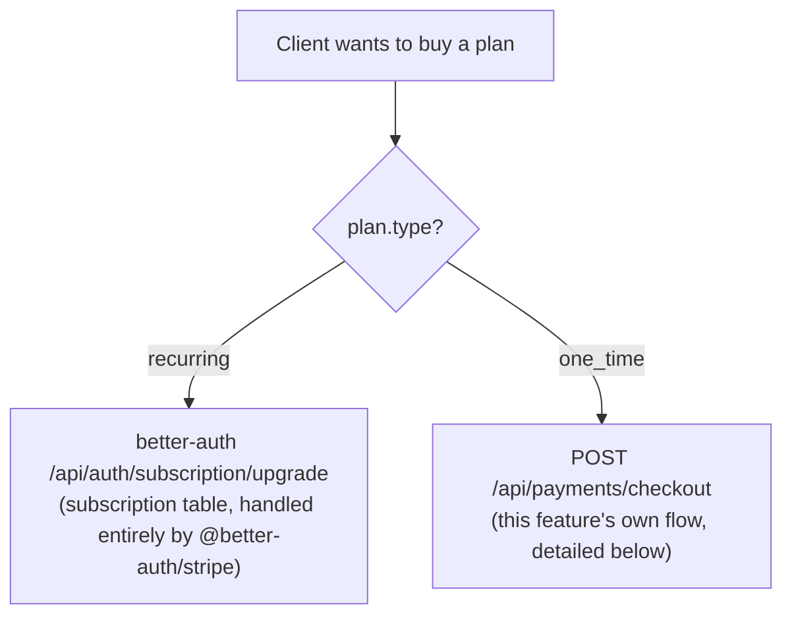
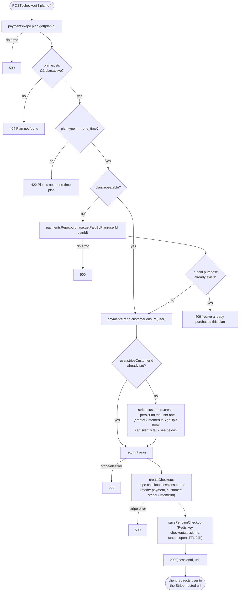
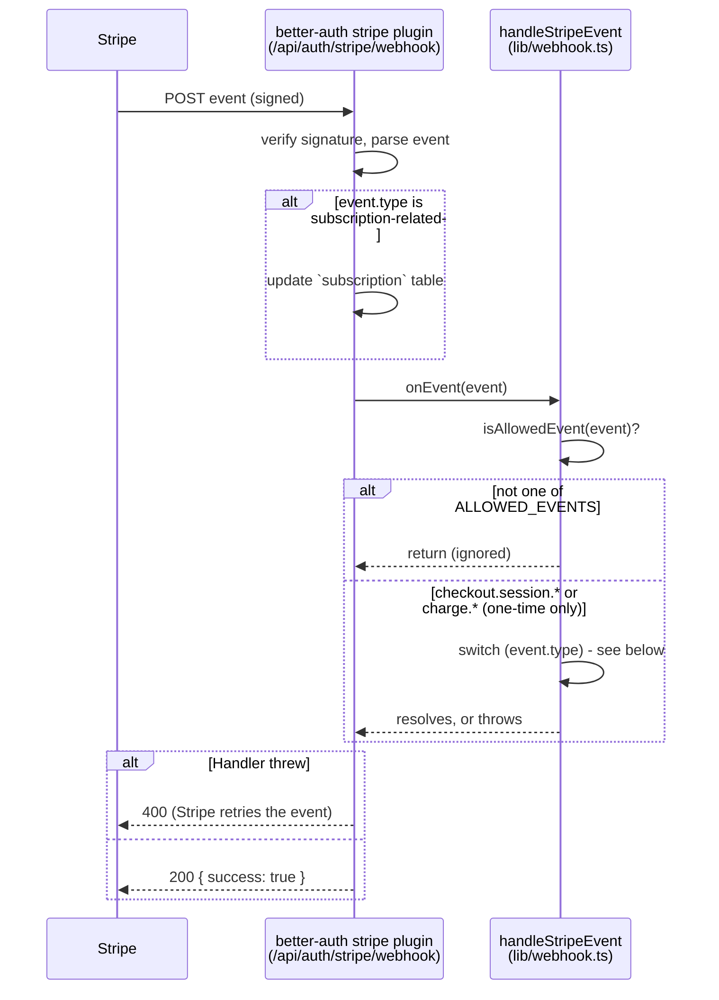
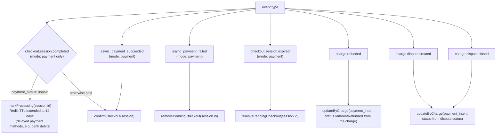
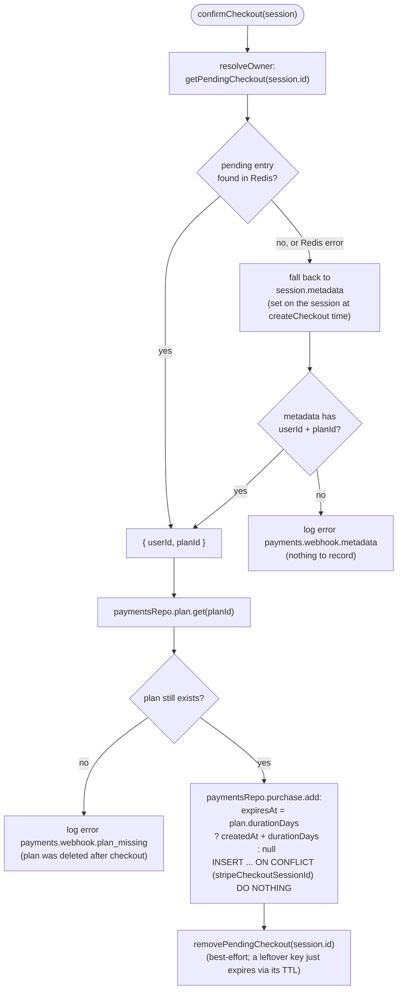
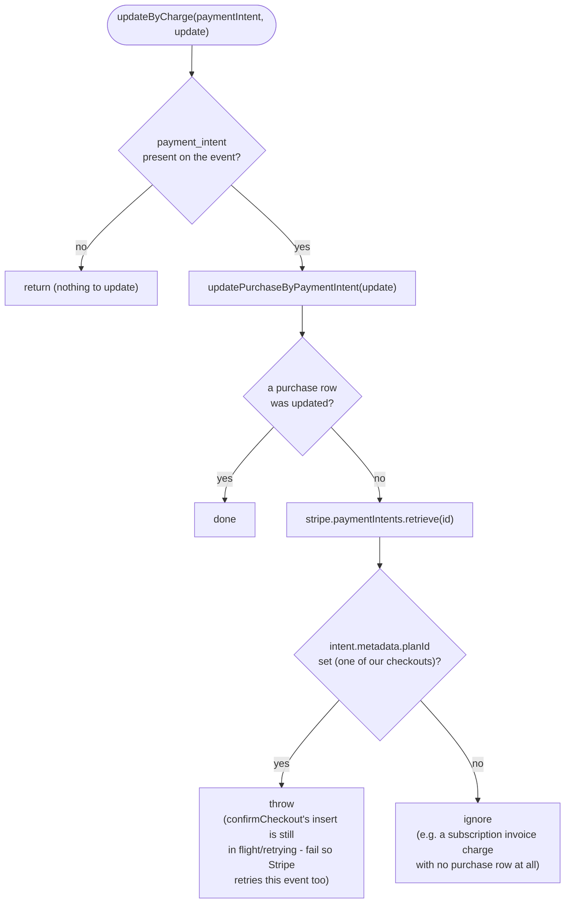
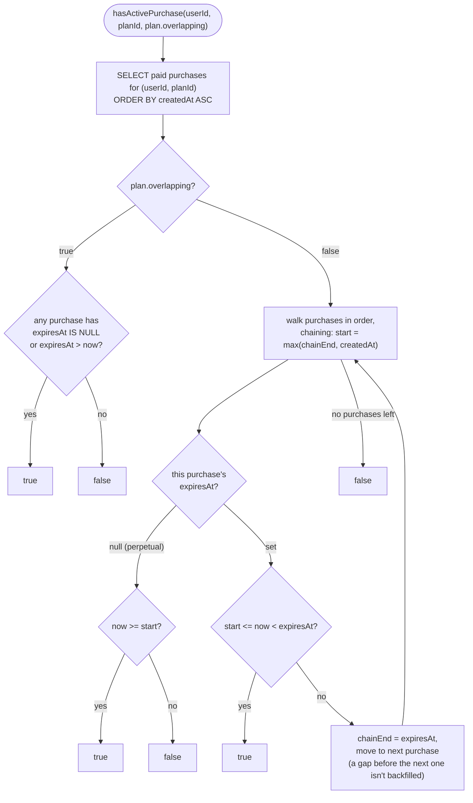

# Payments control flow

This documents how `src/features/payments` actually behaves at runtime. See the
[README](../../../README.md#payments) for the endpoint table and the two-plan-type summary.

## Overview: where the two plan types diverge

`plan.type` decides which of two entirely separate systems handles the purchase.
`recurring` is better-auth's own stripe plugin (its own tables, its own webhook
handling); `one_time` is this feature's own Checkout + webhook + `purchase` table.
This doc only covers the `one_time` path in detail.

## `POST /checkout`: creating a one-time Checkout Session

`route.ts`'s handler, in the order the checks actually run:

`GET /checkout/:sessionId` (`getCheckoutStatus`) answers the client's polling: it
reads the `purchase` row if one exists yet (`paid`/`refunded`/`disputed`), otherwise
falls back to the pending Redis entry (`open`/`processing`), otherwise `null` → 404.

## Stripe webhook dispatch

Every Stripe event - recurring or one-time - lands on the **same** endpoint,
`/api/auth/stripe/webhook`, owned by `@better-auth/stripe`. It verifies the
signature, handles `customer.subscription.*` and subscription-mode
`checkout.session.completed` itself (writing the `subscription` table directly),
then *always* forwards the raw event to the `onEvent` hook this app wired up to
`handleStripeEvent` in `lib/webhook.ts` - regardless of event type.

`ALLOWED_EVENTS` (`lib/constants.ts`): `checkout.session.completed`,
`checkout.session.async_payment_succeeded`, `checkout.session.async_payment_failed`,
`checkout.session.expired`, `charge.refunded`, `charge.dispute.created`,
`charge.dispute.closed`. Everything else (including every subscription event) is
a no-op for this feature - the plugin already dealt with it above.

### `handleStripeEvent`'s switch

### `confirmCheckout`: turning a paid session into a `purchase` row

`addPurchase` is idempotent on `stripeCheckoutSessionId`, so a retried
`checkout.session.completed` (Stripe's at-least-once delivery) is a no-op the
second time. Each purchase's `expiresAt` is computed from **its own**
`createdAt`, independent of any other purchase of the same plan - storage never
chains purchases together (see "checking active access" below).

### `updateByCharge`: refunds and disputes

## Checking active access: `hasActivePurchase`

Nothing calls this yet, but it's the intended way to answer "does this user
currently have access to this plan" once something needs to. Storage is always
independent rows (`expiresAt` per purchase, never chained) - `plan.overlapping`
only changes how they're *read*.

## Where `repeatable`, `durationDays` and `overlapping` come from

All three live on `plan` and only matter for `type: one_time` (a `recurring`
plan's lifecycle is governed by its Stripe subscription period instead, and
`insertPlanSchema` rejects `durationDays` on recurring plans):

| Column | Meaning | Read by |
| --- | --- | --- |
| `repeatable` | can the same user buy this plan more than once at all | `POST /checkout`'s `getPaidByPlan` guard |
| `durationDays` | days of access one purchase grants from its own `createdAt`; `null` = never expires | `addPurchase` (sets `purchase.expiresAt`) |
| `overlapping` | when a user has multiple paid purchases of the plan, can their access windows run concurrently (`true`) or must a later one chain on after an earlier one expires (`false`) | `hasActivePurchase` |
