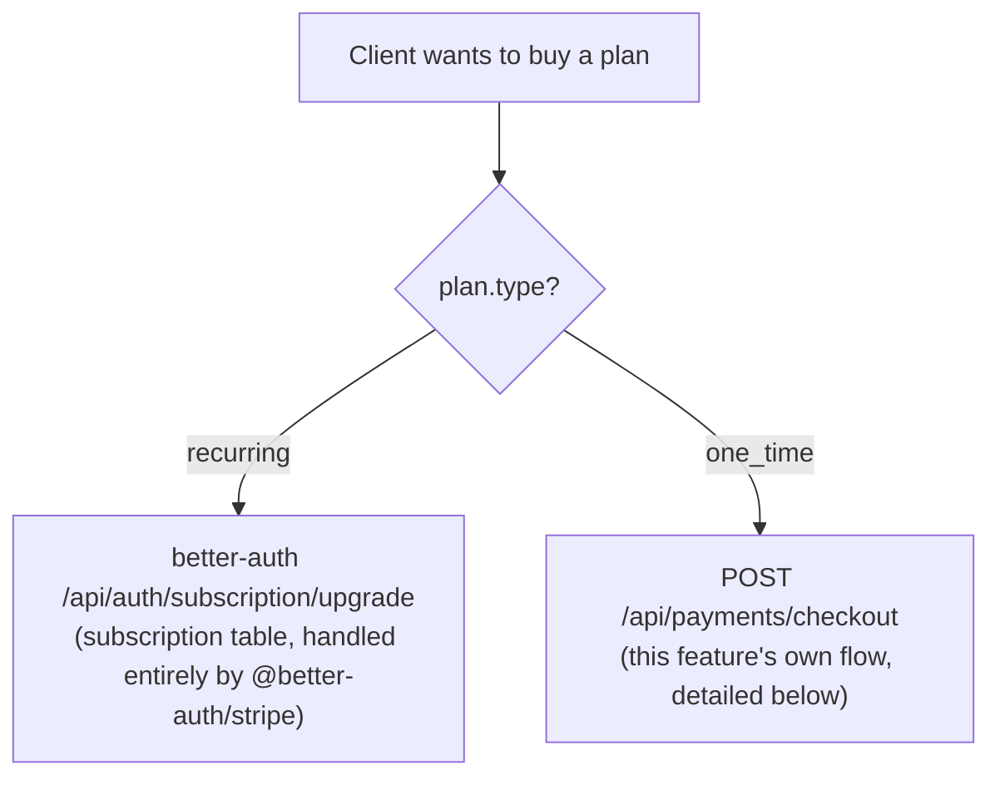
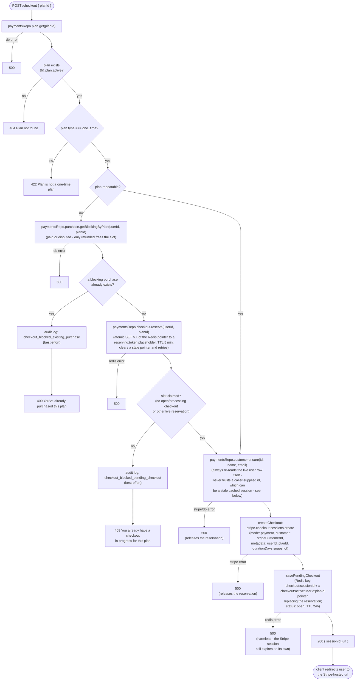
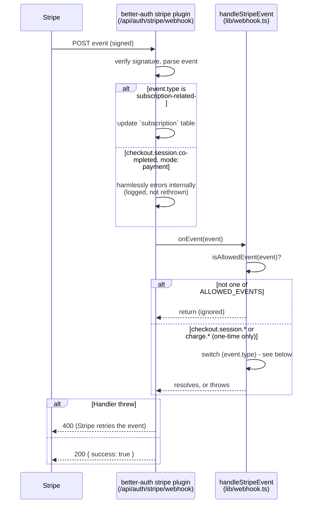
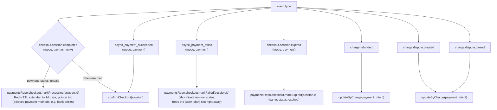
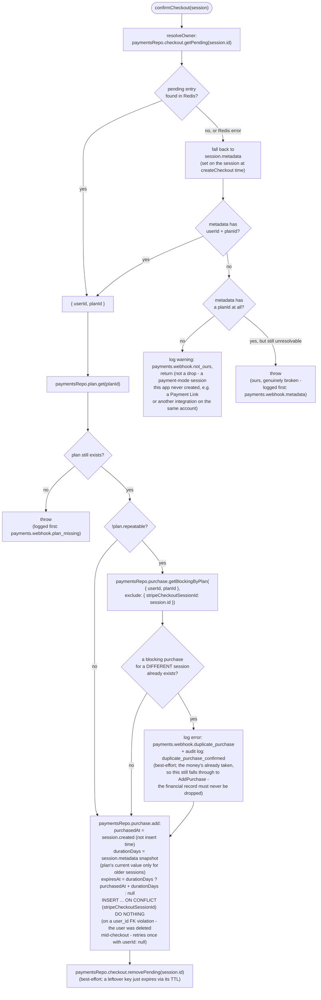
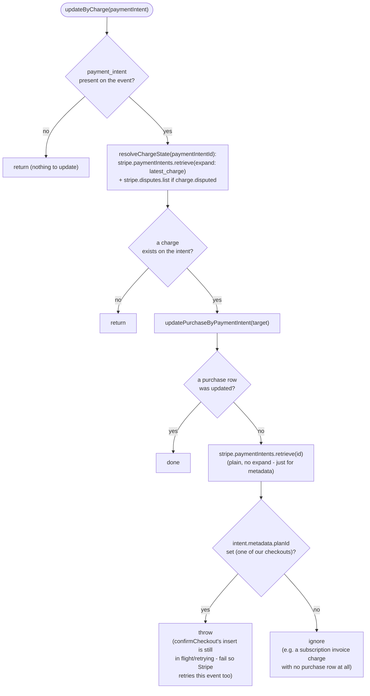
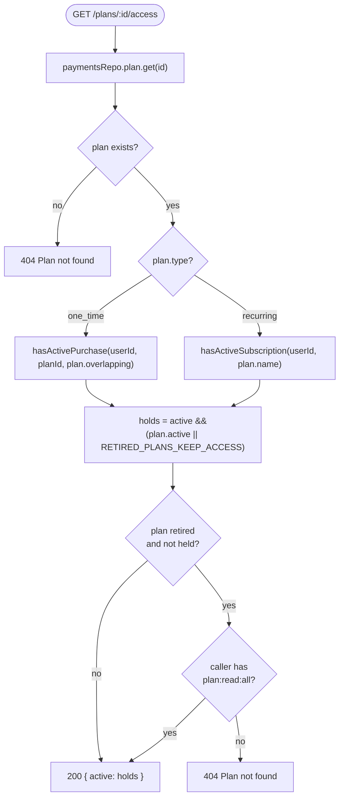
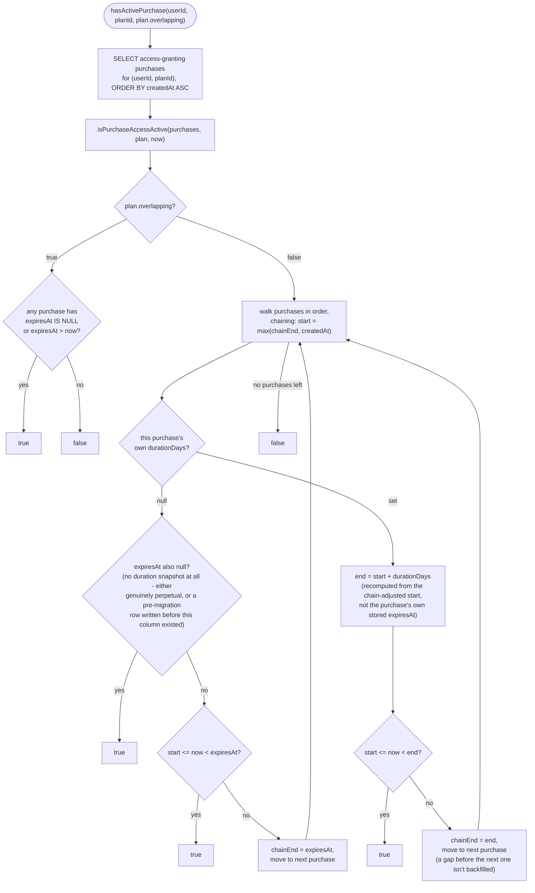

# Payments control flow

This documents how `src/features/payments` actually behaves at runtime. See the
[README](../../../README.md#payments) for the endpoint table and the two-plan-type summary.

## Overview: where the two plan types diverge

`plan.type` decides which of two entirely separate systems handles the purchase.
`recurring` is better-auth's own stripe plugin (its own tables, its own webhook
handling); `one_time` is this feature's own Checkout + webhook + `purchase` table.
This doc only covers the `one_time` path in detail.

## `POST /checkout`: creating a one-time Checkout Session

`route.ts`'s handler, in the order the checks actually run. The two guards under
`plan.repeatable` close the realistic "two tabs" race (a user opening a second
checkout before the first confirms). The second one is an atomic reservation
(`SET NX` on the `checkout:active:userId:planId` pointer), not a check followed by
a later write, so two concurrent requests can't both get past it and both reach
Stripe. They still can't close every race - see `confirmCheckout`'s own re-check
further down for the narrower one that reaches the webhook anyway.

`ensureStripeCustomer` re-reads `user.stripeCustomerId` from Postgres on every
call rather than trusting the session object: better-auth can serve a
Redis-cached `user` blob without querying Postgres at all, and this function's
own raw DB write bypasses the adapter hook that would otherwise refresh that
cache - so a value read from the session can be stale. It also passes a
`customer-<userId>` Stripe idempotency key, so a retried call can't create a
second customer (though it doesn't fully dedupe two truly simultaneous requests
- Stripe's idempotency semantics don't strictly guarantee that).

### Adding Stripe params: `lib/checkout-extensions.ts`

`createCheckout` calls `getCheckoutSessionParams({ user, plan })` before
building the Stripe request - an extension point for promo codes
(`discounts`/`allow_promotion_codes`), tax (`automatic_tax`/`tax_id_collection`),
a different `line_items` quantity, or anything else
`stripe.checkout.sessions.create` accepts that this app doesn't set itself.
Mirrors `@better-auth/stripe`'s own `subscription.getCheckoutSessionParams`
option for the subscription flow (verified in
`node_modules/@better-auth/stripe/dist/index.mjs`) - same idea, for this
flow. The default implementation returns `undefined` (no-op); an app wanting
any of this edits the function directly, the same "change it here, not
where it's read" convention `access-policy.ts` already established.

What always wins over whatever it returns, by object-literal ordering in
`createCheckout` (the explicit fields are listed after the extension's
params are spread first) - `mode`, `customer`, `client_reference_id`,
`success_url`, `cancel_url`, and `expires_at` (kept in lockstep with
`PENDING_CHECKOUT_TTL_SEC`; letting it drift would open a window where
Stripe still accepts the session but Redis has already forgotten it). The
`userId`/`planId`/`durationDays` keys of `metadata` and
`payment_intent_data.metadata` also always win (merged rather than replaced
wholesale, so an app can still tag a session with its own additional keys
alongside them) - `confirmCheckout` and the reconciler depend on those three
to resolve a session back to a purchase at all. `line_items` is
deliberately **not** protected, unlike the subscription plugin (which has
its own seat/multi-item logic to guard) - a returned `line_items` fully
replaces the `[{ price, quantity: 1 }]` default, since nothing else here
depends on it. That's the mechanism for a different quantity.

`GET /checkout/:sessionId` (`getCheckoutStatus`) answers the client's polling: it
reads the `purchase` row if one exists yet (`paid`/`refunded`/`disputed`), otherwise
falls back to the pending Redis entry (`open`/`processing`/`failed`/`expired` - the
last two are short-lived terminal states, see `markFailed`/`markExpired` below),
otherwise `null` → 404. 404 is reserved for a session the user never had at all;
`failed`/`expired` both answer with 200 so a polling client can tell "your payment
failed" apart from "this session never existed."

## Stripe webhook dispatch

Every Stripe event - recurring or one-time - lands on the **same** endpoint,
`/api/auth/stripe/webhook`, owned by `@better-auth/stripe`. It verifies the
signature, handles `customer.subscription.*` internally (writing the
`subscription` table directly), then *always* forwards the raw event to the
`onEvent` hook this app wired up to `handleStripeEvent` in `lib/webhook.ts` -
regardless of event type.

Its own `checkout.session.completed` handler runs for **every** session mode
except `"setup"` - including one-time (`mode: "payment"`) sessions, not just
subscription ones. For a one-time session it calls `subscriptions.retrieve`
with no subscription id, which throws and is caught and logged internally as
`"Stripe webhook failed"` on every single one-time purchase - noisy, but
harmless, and worth knowing about so it isn't mistaken for a real error during
on-call triage (see "known noise" below).

`ALLOWED_EVENTS` (`lib/constants.ts`): `checkout.session.completed`,
`checkout.session.async_payment_succeeded`, `checkout.session.async_payment_failed`,
`checkout.session.expired`, `charge.refunded`, `charge.dispute.created`,
`charge.dispute.closed`. Everything else (including every subscription event) is
a no-op for this feature - the plugin already dealt with it above.

### `handleStripeEvent`'s switch

`markProcessing`/`markFailed`/`markExpired` all go through `pending-checkout.ts`'s
`transition`, which only moves a status forward (`open` → `processing` →
`failed`/`expired`, ranked in that order) and never backward - a retried or
out-of-order event for a status the session has already passed (e.g. a redelivered
unpaid `completed` arriving after `async_payment_failed`) is a no-op. `transition`
also never repoints the `checkout:active:userId:planId` pointer away from a newer
session: `markFailed`/`markExpired` clear it only if it still points at this
session, and `markProcessing` extends it to the same 14 days as the entry only if
it still points at this session (or is free). The extension matters: without it
the pointer kept its original 24h TTL, so for days 2-14 of a bank debit the guard
stopped seeing the checkout and a second one could be opened. Both pointer
operations are atomic Lua scripts, so a newer session written between the check
and the write is never lost.

### `confirmCheckout`: turning a paid session into a `purchase` row

Both drop branches below **throw** rather than log-and-return: a silently
swallowed 200 would mean a payment with no trace of ever going wrong (Stripe
never retries, and a later reconciler pass that hits the same drop would
otherwise miscount it as a successful insert - see the reconciler section).

The `exclude` on `getBlockingByPlan` matters for a Stripe redelivery of the *same*
session: without it, the second delivery would find the purchase row the first
delivery just wrote and wrongly flag it as `duplicate_purchase_confirmed` - the
blocking check only looks for a *different* session's purchase.

`addPurchase` is idempotent on `stripeCheckoutSessionId`, so a retried
`checkout.session.completed` (Stripe's at-least-once delivery) is a no-op the
second time. `createdAt`/`expiresAt` are derived from the Stripe session's own
`created` timestamp, not insert time - so a purchase recorded late (e.g. by the
reconciler) doesn't get bonus days of access. For the same reason, `durationDays`
comes from the snapshot `createCheckout` writes into the session's metadata
(`"none"` for a never-expiring plan, since Stripe drops empty metadata values),
not the plan's value when the payment confirms - an admin edit while a bank debit
is settling must not change what that buyer gets. Sessions created before the
snapshot existed fall back to the plan's current value
(`payments.webhook.duration_snapshot_missing`). That value is then stored on the
purchase row, independent of any other purchase of the same plan or any later
edit to the plan itself (see "checking active access" below).

`confirmCheckout` returns whether it actually inserted the row (`false` for a
redelivery, a session that isn't ours, or the reconciler losing a race to the
webhook).

### `updateByCharge`: refunds and disputes

Never trusts a webhook event's own embedded payload for the resulting state -
Stripe doesn't guarantee delivery order, so an out-of-order or retried event's
payload can be stale. Always re-fetches the current charge/dispute from Stripe
instead (`resolveChargeState` in `lib/charge-state.ts`), the same function the
reconciler uses.

## The reconciler: `lib/reconcile.ts` (`bun run payments:reconcile`)

A backstop for webhooks Stripe gave up retrying. Lists recent one-time Checkout
Sessions directly from Stripe and, per session: inserts a `purchase` row via
`confirmCheckout` if none exists yet, then syncs refund/dispute state via the
same `resolveChargeState` the webhook uses. `scripts/reconcile.ts` is just its
CLI wrapper (arg parsing, exit code); the logic importable from `lib/reconcile.ts`
is what `reconcile.test.ts` exercises directly.

Counting is tied to what actually happened, not attempted: `inserted` only
increments when `confirmCheckout` reports it actually inserted the row (or, in
`--dry-run`, would have been attempted) - if it throws (an unresolvable owner, a
deleted plan), that exception propagates out and the session is counted as
`failed` instead, never silently miscounted as a successful insert. The
"already recorded?" lookup (`getBySessionAnyUser`) isn't scoped to the
metadata's `userId`: a purchase whose user was since deleted has `userId: null`,
and a user-scoped lookup would miss it and re-count it as inserted on every run.

The default scan window is 14 days (derived from `PROCESSING_TTL_SEC`), not 7 -
delayed payment methods (e.g. bank debits) can take that long to settle, and a
late settlement whose webhook was lost needs to still fall inside the window.

### `runSubscriptions`: correcting stale subscription rows

A second, independent reconciler pass, triggered by `GET /plans/:id/access`
now reading the `subscription` table directly (see below) - a table the
`@better-auth/stripe` plugin writes straight from each webhook's payload,
with no protection against an out-of-order or retried `customer.subscription.*`
event overwriting a newer status. That used to be harmless (nothing read the
table); now it decides access, so it needs its own backstop.

Deliberately *not* a Stripe call inside `onEvent`: that would mean one API
call per webhook event, and Stripe enforces hard rate limits a real app's
webhook volume can realistically hit. Instead this stays a batched pass, same
shape as the one-time-purchase reconciler above, just scoped differently -
subscriptions have no creation-time window to scan (a status can change long
after creation, unlike a Checkout Session's short confirmation window), so
instead of `days`, it scopes by status: `getReconcilableSubscriptions` skips
any row already `canceled` or `incomplete_expired`, since Stripe guarantees
neither ever changes again.

`runSubscriptions` bulk-lists every subscription from Stripe
(`stripe.subscriptions.list()`, auto-paginated, no status filter) in one
pass, rather than retrieving each reconcilable row one by one - call volume
scales with *total subscriptions on the account divided by 100*, not with
how many rows need checking, which stays comfortably within rate-limit
budget even as subscriber count grows. Each listed subscription is matched
back to a reconcilable row by `stripeSubscriptionId`; unmatched rows are
handled after the loop (see below).

For each matched row, `reconcileSubscription` diffs the listed subscription
against the stored row and - unless it's a dry run - corrects it via
`updateSubscriptionFields`. The same mutable fields `@better-auth/stripe`'s
own webhook handlers write get touched: `status`, `periodStart`,
`periodEnd`, `trialStart`, `trialEnd`, `cancelAtPeriodEnd`, `cancelAt`,
`canceledAt`, `endedAt`, and - **not** an identity field, despite an earlier
version of this doc claiming otherwise - `plan`. The plugin re-resolves
`plan` from the subscription's current price on every
`customer.subscription.updated` (`resolvePlanItem` in its source), so a lost
or out-of-order webhook for a plan *change* (Basic -> Pro) is exactly the
kind of staleness this reconciler exists to catch; `getPlanByPriceId`
mirrors that same price-matching lookup
(`stripePriceId`/`annualDiscountPriceId`), and `plan` is only corrected when
a configured plan actually matches the current price - left untouched
otherwise, mirroring the plugin's own "no match -> no update" behavior,
rather than guessing or nulling it out. `referenceId`, `stripeCustomerId`
and `stripeSubscriptionId` itself remain the only genuine identity fields,
set once at creation and never rewritten here. `periodStart`/`periodEnd` are
read from `sub.items.data[0]`, not the subscription object's own top-level
fields, matching exactly where the plugin itself reads them from (Stripe
moved period fields to the item level) - same simplification applies to the
price lookup (first item only), which only matters for multi-item/seat
subscriptions this app doesn't use.

A reconcilable row never matched against the list - a wrong or orphaned
`stripeSubscriptionId`, not a normal occurrence - is counted as `failed`
under its own message (`payments.reconcile.subscription_not_found`), the
same visibility a failed per-row lookup would have given; switching to
bulk-listing must not make a genuinely broken row go silently unnoticed.

Not covered: a subscription that exists in Stripe but has no row at all.
Unlike one-time purchases (which only ever exist once an async webhook
confirms them), the plugin creates the row synchronously as part of its own
checkout/upgrade flow, before any webhook fires - a genuinely missing row is
a much rarer failure mode than a stale one, and isn't what this pass targets.

`scripts/reconcile.ts` runs both passes every invocation and logs them under
separate messages (`payments.reconcile.summary` for the existing one-time
pass, `payments.reconcile.subscriptions_summary` for this one) so neither
affects how the other is parsed; the exit code is 1 if *either* pass failed.

## Checking active access: `GET /plans/:id/access`

The route that answers "does the caller currently have access to this
plan" (404 if the plan doesn't exist). Which of the two feature's two systems
it checks depends on `plan.type`, mirroring the same split as checkout above.
`GET /access` answers the broader question - every plan the caller has access
to - with the same rules (see "Every active plan" below).

A retired (`active: false`) plan is only revealed to someone who still holds
it (when `RETIRED_PLANS_KEEP_ACCESS` is on, the default) or to an admin with
`plan:read:all`; anyone else gets the same 404 as a plan that never existed,
matching `GET /plans/:id`.

### `one_time`: `hasActivePurchase`

Fetches the user's purchases of the plan with an access-granting status
(`PURCHASE_ACCESS_STATUSES`), then hands them to `isPurchaseAccessActive`
(`lib/utils.ts`) - a pure function shared with `GET /access`'s
`getActivePlans`, so the two can never read `overlapping` chaining
differently. Storage is always independent rows - each purchase's own
`durationDays` is snapshotted at purchase time, never chained with any other
purchase's - so `plan.overlapping` only changes how they're *read*:
`overlapping: false` recomputes each purchase's end as `(chain-adjusted
start) + its own durationDays`, rather than trusting its
independently-computed `expiresAt`, so a later purchase bought before an
earlier one lapses correctly extends access instead of shortening it. A row
with no `durationDays` snapshot at all falls back to its own `expiresAt`
instead of being treated as perpetual - that distinguishes a genuinely
never-expiring purchase (`expiresAt` also `null`) from a pre-migration row
that predates this column and was never backfilled.

### `recurring`: `hasActiveSubscription`

Reads better-auth's own `subscription` table directly (`referenceId` = the
caller's user id - this app never enables the organization plugin, so a
subscription is always keyed by user, never by org) rather than calling the
plugin's `/subscription/list` endpoint: this feature only needs a boolean, not
the limits/priceId enrichment that endpoint adds, and reading the table
avoids reconstructing a session-bearing request just to call it. Matches
`sub.plan` against `plan.name` case-insensitively, the same way the plugin's
own plan lookup does, and treats `SUBSCRIPTION_ACCESS_STATUSES` (`active`/`trialing`) as the active statuses -
mirroring `isActiveOrTrialing`, the check the plugin itself uses to decide
whether a user is already subscribed (e.g. to block a duplicate upgrade) -
rather than also checking `periodEnd`, which the plugin doesn't check either.

A consequence worth being deliberate about: `past_due` isn't in that set, so
access is lost the moment a renewal payment fails, not after Stripe's
multi-day retry schedule for that failed payment runs out. That matches the
plugin's own definition of "subscribed" (reused here for consistency rather
than inventing a second one), but plenty of products choose to grant a grace
period through `past_due` instead. If that's wanted, it's a product decision
to make explicitly - add `"past_due"` to `SUBSCRIPTION_ACCESS_STATUSES` in
`lib/access-policy.ts` - not something that should happen by accident.

## The audit log: `payment_audit_log`

A persistent, queryable trail of the races around `plan.repeatable` that the
two `POST /checkout` guards and `confirmCheckout`'s own re-check write to -
`checkout_blocked_existing_purchase`, `checkout_blocked_pending_checkout`, and
`duplicate_purchase_confirmed` (the one where money was actually taken for an
already-owned non-repeatable plan, and the purchase is still recorded - see
above). All three writes are best-effort: a failure is logged as a warning and
never blocks the response or webhook outcome it's attached to. `GET
/audit-log` (admin, `audit:list`) exposes it - every entry, most recent
first, or one customer's via `?userId=`, backed by
`paymentsRepo.audit.getAll`/`getByUser` respectively. It's paginated by
keyset: `?limit=` (default 50, max 100) and `?before=<id>`, where the response's
`nextCursor` is the `before` for the next, older page (`null` on the last one).
Keyset rather than offset so a page boundary doesn't shift while new entries
keep arriving; ordered by `id`, which is unique and assigned in insertion order.

## Purchases across every user: `GET /purchases/all`

The admin counterpart to `GET /purchases` (which only ever returns the
caller's own, unpaginated - that stays as-is). Same keyset-pagination
mechanism as `GET /audit-log` above, just applied to `purchase` rows instead
of `payment_audit_log` ones - its own `?limit=`/`?before=`/`nextCursor`,
gated by its own permission (`purchase:read:all`, admin-only - there's no
"read:active" tier here the way `plan` has, since "see your own" is already
covered by `GET /purchases` needing no permission at all), and its own page-
size constants (`PURCHASES_DEFAULT_LIMIT`/`MAX_LIMIT` in `lib/constants.ts`)
rather than reusing the audit log's, since the two are different resources
that might reasonably want different limits later. Backed by
`paymentsRepo.purchase.getAllAdmin`/`getByUserAdmin`
(`use-cases/get-purchases.ts`), narrowed to one customer via `?userId=` the
same way the audit log is.

## Every active plan: `GET /access`

`paymentsRepo.access.getActivePlans` returns every plan the user has access to
right now, across both types, each with its `limits` - for an app that gates
features by what a user holds rather than by one specific plan id. It applies
exactly the same rules as the single-plan checks above: one-time plans via
`isPurchaseAccessActive` (the same pure function `hasActivePurchase` uses, so
`overlapping` chaining can't drift between the two), recurring plans via the
`subscription` table matched by name. Two queries total, however many plans the
user holds.

It deliberately stops at listing. Combining several plans' `limits` into one
answer (highest wins? add up? any-true?) depends entirely on what those limits
mean, so that's left to the app.

## Access policy: `lib/access-policy.ts`

Every product decision about who has access lives in this one file as a named,
documented constant, rather than inside the queries that read it:

| Setting | Default | Change it to |
| --- | --- | --- |
| `SUBSCRIPTION_ACCESS_STATUSES` | `active`, `trialing` | add `past_due` for a grace period during Stripe's retries |
| `PURCHASE_ACCESS_STATUSES` | `paid` | add `disputed` to keep access until a dispute is lost |
| `PURCHASE_BLOCKING_STATUSES` | `paid`, `disputed` | what stops a non-repeatable plan being bought again |
| `PARTIAL_REFUND_REVOKES_ACCESS` | `false` | `true` to end access on any refund |
| `RETIRED_PLANS_KEEP_ACCESS` | `true` | `false` to end access when a plan is deactivated |
| `CANCEL_ON_USER_DELETE` | cancel now, no proration | `prorate: true` to credit unused time |

`SUBSCRIPTION_TERMINAL_STATUSES` sits alongside them but isn't a choice - it's
Stripe's own list of statuses that never change again.

## Retiring a plan

Deactivating a plan (`PATCH /plans/:id { active: false }`) stops new purchases
and keeps existing ones working:

- **One-time:** `POST /checkout` already 404s an inactive plan. Existing
  purchases keep their access per `RETIRED_PLANS_KEEP_ACCESS`.
- **Recurring:** `getSubscriptionPlans` hands the stripe plugin *every*
  recurring plan, retired ones included, and `blockRetiredPlanUpgrade`
  (`lib/plan-retirement.ts`, wired as better-auth's `hooks.before`) refuses
  `/subscription/upgrade` to a retired plan with the same
  `SUBSCRIPTION_PLAN_NOT_FOUND` answer the plugin gives an unknown plan. The
  plugin uses one plan list for two jobs - what can be subscribed to, and
  which plan an existing subscription is on - and dropping a retired plan from
  it broke the second: its subscribers came back from `/subscription/list`
  with no `limits`, and for a multi-item subscription the plugin's
  `customer.subscription.updated` handler stopped syncing the row at all. The
  hook also blocks switching an existing subscription of a retired plan
  between monthly and annual (same endpoint) - retiring means no new
  commitments. Cancel, restore and the billing portal don't consult the plan
  list and keep working either way.

Changing a price for existing subscribers isn't covered: create a new plan,
retire the old one, and existing subscribers stay on the old price until they
change plan.

## Deleting a user

`cancelSubscriptionsForDeletedUser` (`lib/user-deletion.ts`) is wired to
better-auth's `databaseHooks.user.delete.before`, which every deletion path
goes through - the admin plugin's `removeUser` and the self-service
`/delete-user` alike. Neither `@better-auth/stripe` nor anything else here
cancelled a deleted user's subscriptions before this, so a deleted user kept
being billed (the plugin only has a hook for deleting organizations, which
this app doesn't use).

It lists the customer's subscriptions from Stripe rather than reading the
`subscription` table, so a subscription with a missing or stale row is still
caught, and cancels every one not already in a terminal status, on
`CANCEL_ON_USER_DELETE`'s terms. It fails closed: if a cancellation fails, it
throws, better-auth aborts the deletion, and the user stays - never deleted
while still billed. Retrying is safe, since already-cancelled subscriptions
are skipped. The Stripe customer itself is kept, for the same reason `purchase`
rows outlive their user: its payment history is still needed for refunds and
disputes.

## Where `repeatable`, `durationDays` and `overlapping` come from

All three live on `plan` and only matter for `type: one_time` (a `recurring`
plan's lifecycle is governed by its Stripe subscription period instead, and
`insertPlanSchema` rejects `durationDays` on recurring plans):

| Column | Meaning | Read by |
| --- | --- | --- |
| `repeatable` | can the same user buy this plan more than once at all | `POST /checkout`'s and `confirmCheckout`'s `getBlockingByPlan` guards (a `paid` or `disputed` purchase blocks; only `refunded` frees the slot) |
| `durationDays` | days of access one purchase grants from its own `createdAt`; `null` = never expires | `addPurchase`, which snapshots it onto `purchase.durationDays` and derives `purchase.expiresAt` from it |
| `overlapping` | when a user has multiple paid purchases of the plan, can their access windows run concurrently (`true`) or must a later one chain on after an earlier one expires (`false`) | `hasActivePurchase` |

All three (plus `limits`, `active`, `trialDays`) are editable via `PATCH /plans/:id` -
pricing/identity fields (`name`, `type`, `amount`, `interval`, the Stripe ids) aren't,
since they're either baked into an already-created Stripe Price or relied on as a
lookup key elsewhere (`name`, by `getSubscriptionPlans`). An edit to `durationDays`
only affects checkouts started *after* it - `createCheckout` snapshots the plan's
`durationDays` into the session's metadata, and `addPurchase` stores that snapshot
on the purchase row, so it never rewrites history for purchases already made or
still settling. Flipping `repeatable` from `false` to `true` is rejected
(409) while any user still has a blocking purchase of the plan
(`paymentsRepo.purchase.hasAnyBlocking`) - otherwise it would silently reopen a
once-only/trial plan to every past purchaser, not just whoever's buying it next.
Setting `durationDays` on a plan whose `type` isn't `one_time`, or `trialDays` on
one whose `type` isn't `recurring`, is also rejected (422) - the same type/field
pairing `insertPlanSchema` already enforces at creation time, now enforced on
every edit too (fetched from the DB in the route handler itself, since `type`
isn't a patchable field the update payload could be checked against directly).

## The trial pattern

Two unrelated things both get called "trial" here - don't confuse them:

- **One-time paid trial** (e.g. $1 for 7 days): a `one_time` plan with
  `repeatable: false` and `durationDays` set. This is *this feature's own*
  gating, not a separate mechanism - but the two halves are independent, not
  chained: `getBlockingPurchaseByPlan` blocks a second purchase purely on
  purchase *status* (`paid`/`disputed`), with no regard for `durationDays` or
  `expiresAt` at all, while `hasActivePurchase` (access) and `durationDays`
  (how long one purchase's access lasts) are a separate axis entirely. So a
  non-repeatable trial is "once ever per account, until refunded" - buying it
  does *not* become possible again once the trial's own access window lapses.
  That's the point: a trial is meant to be spent once and not retried
  indefinitely as it keeps expiring.
- **Subscription trial** (e.g. 14 days of Pro, then it bills): `trialDays`
  on a `recurring` plan, handled entirely by `@better-auth/stripe` - it
  grants the trial, auto-bills when it ends, and only grants one per account
  by checking the user's subscription history before creating another. None
  of this feature's code is involved.

A genuinely *free*, one-time (non-subscription) trial isn't supported and
doesn't need to be: `insertPlanSchema` requires `amount` to be positive, and
Stripe Checkout in `payment` mode can't settle a $0 total without a coupon -
every realistic "free trial" need is the subscription-trial shape above,
which better-auth already owns end-to-end.

## Known noise / tech debt (not fixed here)

- **Spurious plugin log on every one-time purchase** - see "Stripe webhook
  dispatch" above. Vendor behavior (`@better-auth/stripe`'s
  `onCheckoutSessionCompleted` doesn't early-return for `mode: "payment"`); no
  code fix without patching the dependency.
- **Dependency version mismatch** - this repo runs `stripe@23`, but
  `@better-auth/stripe`'s declared peer range stops at `^22` (and separately,
  its peer on `better-auth` itself is `^1.7.7` while this repo runs `1.7.4`).
  Nothing is currently broken; revisit if an actual incompatibility surfaces.
- **`reservePendingCheckout`'s TTL-based lock has a narrow theoretical gap** -
  `RESERVATION_TTL_SEC` (5 min) is generous enough to outlast
  `ensureStripeCustomer` + `checkout.sessions.create` under any normal
  network condition, but it's still a TTL, not a true lock: if the request
  somehow took longer than that, a second request could claim the slot
  before `savePendingCheckout` overwrites the reservation with the real
  session id, and both would reach Stripe. Accepted as effectively
  unreachable in practice rather than engineered around.
